# Arquitetura do toolbelt (`tb`)

## Visão Geral

O `toolbelt` é um conjunto de ferramentas para agentes de código com IA, unificadas sob um único binário (`tb`) e protocolo. O objetivo é fornecer um ambiente seguro, eficiente e auditável para que agentes autônomos executem tarefas de desenvolvimento.

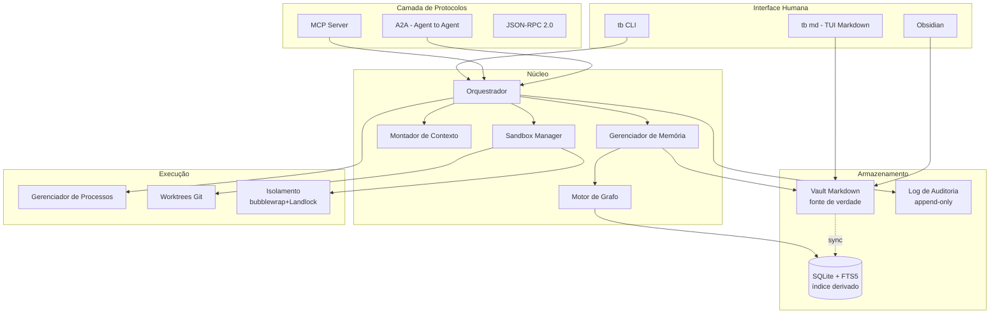

---

## 1. Workspace e Sandbox

### 1.1 Isolamento por Worktree

Cada agente opera em um **git worktree** dedicado, permitindo:

- Trabalho paralelo sem conflitos de branch
- Snapshot e rollback instantâneos via git
- Limpeza simples ao finalizar a tarefa

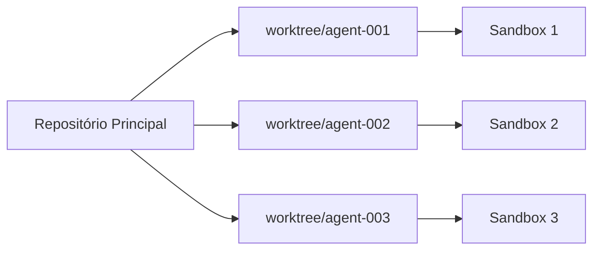

### 1.2 Camadas de Isolamento

| Camada | Tecnologia | Responsabilidade |
|--------|------------|------------------|
| Filesystem | bubblewrap | Monta apenas diretórios permitidos; bind-mount read-only para testes |
| Syscalls | seccomp | Lista de syscalls permitidos por perfil de tarefa |
| Filesystem (runtime) | Landlock | Restrições de acesso mesmo para processos filhos |
| Recursos | cgroups v2 | Limites de CPU, RAM, tempo de execução |
| Rede | netns/bubblewrap | Negada por padrão; whitelist explícita |

### 1.3 Snapshot e Rollback

Antes de cada tarefa:
1. `git stash --include-untracked` ou commit temporário
2. Hash do estado salvo no log de auditoria
3. Execução da tarefa no sandbox
4. Em caso de falha ou violação: `git reset --hard` + `git clean -fdx`

---

## 2. Memória vs Contexto

**Memória** e **contexto** são conceitos distintos:

| Aspecto | Memória | Contexto |
|---------|---------|----------|
| **Definição** | Armazenamento persistente de fatos, decisões, sumários e grafo | O que é montado na janela do modelo para uma tarefa específica |
| **Persistência** | Permanente (vault Markdown + SQLite) | Efêmera (dura uma requisição) |
| **Tamanho** | Ilimitado (cresce com o projeto) | Limitado pelo orçamento de tokens |
| **Formato** | Markdown + frontmatter + grafo | Texto serializado para o prompt |

### 2.1 Tipos de Contexto

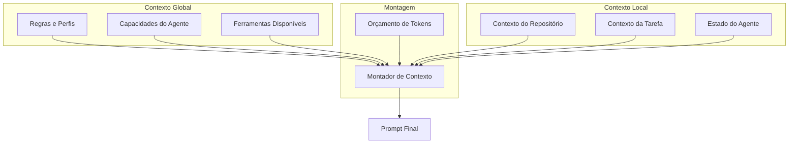

### 2.2 Hierarquia de Contexto

1. **Global**: regras do sistema, perfil do usuário, ferramentas MCP disponíveis
2. **Repositório**: estrutura do projeto, convenções, dependências principais
3. **Agente**: role/persona, histórico recente, capacidades específicas
4. **Tarefa**: objetivo, arquivos relevantes, resultados de queries no grafo

O **Montador de Contexto** recebe um orçamento de tokens e prioriza informações mais relevantes, truncando ou sumarizando quando necessário.

---

## 3. Armazenamento: Vault Markdown + SQLite/FTS5

### 3.1 Vault Markdown (Fonte de Verdade)

Inspirado no Obsidian, a memória é um vault de arquivos Markdown:

```
.tb/
├── vault/
│   ├── facts/
│   │   ├── projeto-estrutura.md
│   │   └── decisoes-arquitetura.md
│   ├── agents/
│   │   ├── agent-001-log.md
│   │   └── agent-002-log.md
│   ├── summaries/
│   │   └── sprint-2024-01.md
│   └── code/
│       ├── modules/
│       │   └── auth-module.md
│       └── functions/
│           └── parse-config.md
├── index.db          # SQLite derivado
└── audit.log         # Log append-only
```

Cada arquivo usa:
- **Frontmatter YAML**: metadados estruturados (tipo, tags, data, proveniência)
- **Wikilinks**: `[[outro-arquivo]]` para relacionamentos
- **Tags**: `#decision`, `#fact`, `#inferred`
- **Backlinks**: calculados automaticamente

Exemplo de arquivo:

```markdown
---
type: fact
tags: [architecture, database]
created: 2026-01-15T10:30:00Z
source: extracted
confidence: high
---

# Decisão: SQLite para Armazenamento

O projeto usa SQLite como banco de dados principal.

## Justificativa
- Simplicidade de deploy (arquivo único)
- Performance excelente para leitura
- FTS5 para busca full-text

## Relacionamentos
- Implementado em: [[database-module]]
- Decidido em: [[adr-003-sqlite-fts5]]
- Afeta: [[config-schema]], [[migration-system]]
```

### 3.2 SQLite + FTS5 (Índice Derivado)

O SQLite é um **índice derivado**, reconstruído a partir do vault e do código:

```sql
-- Nós do grafo
CREATE TABLE nodes (
    id TEXT PRIMARY KEY,
    type TEXT NOT NULL,           -- 'file', 'function', 'class', 'fact', 'decision'
    path TEXT,                    -- caminho no vault ou no código
    title TEXT,
    content TEXT,
    source TEXT NOT NULL,         -- 'vault', 'code', 'inferred'
    confidence REAL DEFAULT 1.0,  -- 0.0-1.0 para dados inferidos
    created_at TEXT,
    updated_at TEXT,
    metadata JSON
);

-- Índice full-text
CREATE VIRTUAL TABLE nodes_fts USING fts5(
    title, content,
    content='nodes',
    content_rowid='rowid'
);

-- Arestas do grafo
CREATE TABLE edges (
    id INTEGER PRIMARY KEY,
    source_id TEXT NOT NULL,
    target_id TEXT NOT NULL,
    type TEXT NOT NULL,           -- 'calls', 'imports', 'references', 'implements', 'links_to'
    source TEXT NOT NULL,         -- 'extracted', 'inferred', 'manual'
    confidence REAL DEFAULT 1.0,
    metadata JSON,
    FOREIGN KEY (source_id) REFERENCES nodes(id),
    FOREIGN KEY (target_id) REFERENCES nodes(id)
);

-- Índices para queries rápidas
CREATE INDEX idx_edges_source ON edges(source_id);
CREATE INDEX idx_edges_target ON edges(target_id);
CREATE INDEX idx_edges_type ON edges(type);
CREATE INDEX idx_nodes_type ON nodes(type);
CREATE INDEX idx_nodes_path ON nodes(path);

-- Views úteis
CREATE VIEW callers AS
SELECT e.source_id as caller, e.target_id as callee, e.confidence
FROM edges e WHERE e.type = 'calls';

CREATE VIEW dependencies AS
SELECT e.source_id as dependent, e.target_id as dependency, e.confidence
FROM edges e WHERE e.type = 'imports';
```

### 3.3 Sincronização Vault → SQLite

A direção de sync é **unidirecional**: vault → SQLite.

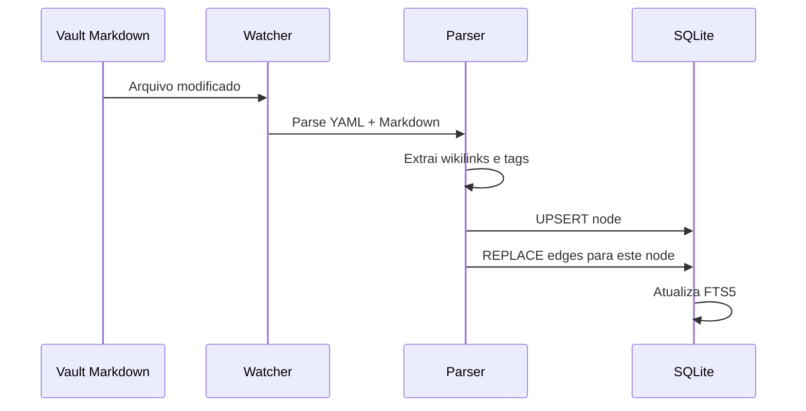

**Resolução de conflitos**: o vault sempre vence. Se o SQLite divergir (corrupção, edição manual), o comando `tb graph rebuild` reconstrói tudo.

### 3.4 Indexação de Código com Proveniência

Inspirado no Graphify, o `tb graph` indexa código via tree-sitter:

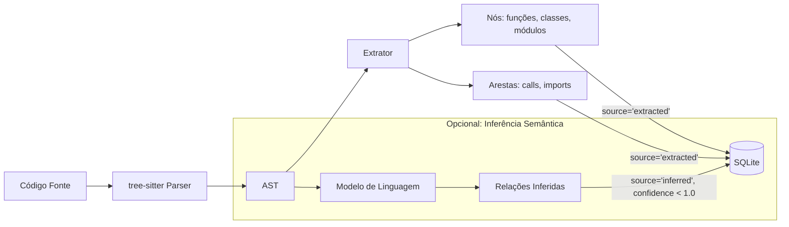

**Proveniência de arestas**:
- `extracted`: derivado diretamente do AST (alta confiança)
- `inferred`: deduzido por LLM ou heurísticas (confiança variável)
- `manual`: inserido por humano via vault

### 3.5 Queries para Agentes

O grafo expõe queries que economizam tokens:

```bash
# Quem chama esta função?
tb graph callers --function "parseConfig" --depth 2

# Quais são as dependências deste módulo?
tb graph deps --module "auth" --transitive

# Qual o impacto de mudar este arquivo?
tb graph impact --file "src/config/parser.go"

# Busca semântica
tb graph search "autenticação JWT"
```

**Hooks para agentes**: antes de ler arquivos brutos, o agente deve consultar o grafo:

```
1. Recebe tarefa: "Corrigir bug no parser de config"
2. tb graph search "parser config" → encontra nós relevantes
3. tb graph callers --function "parseConfig" → entende quem usa
4. tb graph impact --file "parser.go" → avalia escopo
5. Só então lê os arquivos específicos necessários
```

Isso reduz drasticamente o número de tokens consumidos em leitura de arquivos.

---

## 4. Segurança

### 4.1 Modelo de Ameaças

| Ameaça | Mitigação |
|--------|-----------|
| Escape do sandbox | Múltiplas camadas (bubblewrap + Landlock + seccomp) |
| Acesso a secrets | Variáveis injetadas apenas para ferramentas autorizadas; nunca no prompt |
| Modificação de testes | Arquivos de teste read-only + hash verificado |
| Exfiltração de dados | Rede negada por padrão; whitelist explícita |
| Escalação de privilégios | Capacidades mínimas; tokens de capability por ação |
| Reward hacking | Implementador ≠ avaliador; detecção de padrões suspeitos |

### 4.2 Permissões por Capacidade

Cada role tem um conjunto de capacidades:

```yaml
roles:
  worker:
    capabilities:
      - read:code
      - write:code
      - run:tests
      - query:graph
    denied:
      - write:tests
      - delete:*
      - network:*

  supervisor:
    capabilities:
      - read:*
      - write:code
      - approve:worker_changes
      - query:graph
    denied:
      - delete:*
      - network:external

  planner:
    capabilities:
      - read:*
      - write:plans
      - spawn:supervisor
      - query:graph
      - network:internal
```

### 4.3 Tokens de Capacidade para Ações Destrutivas

Ações perigosas requerem tokens de capacidade explícitos:

```go
type CapabilityToken struct {
    Action    string    // "delete:file", "network:external"
    Resource  string    // caminho ou padrão
    GrantedBy string    // quem aprovou
    ExpiresAt time.Time
    Hash      string    // assinatura para verificação
}
```

O fluxo:
1. Agente solicita ação destrutiva
2. Sistema gera token pendente
3. Humano (ou supervisor autorizado) aprova
4. Token é assinado e tem validade curta
5. Ação executa apresentando o token

### 4.4 Handling de Secrets

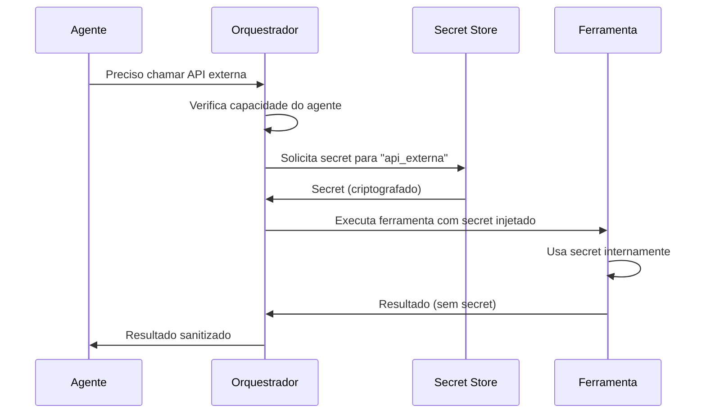

Secrets nunca aparecem:
- No prompt do modelo
- Nos logs
- Na memória do vault
- Nas respostas ao agente

---

## 5. Scripts e Processos

### 5.1 Comandos `tb run` e `tb proc`

```bash
# Execução única com timeout
tb run --timeout 30s "go test ./..."

# Processo de longa duração com logs
tb proc start --name "dev-server" --log /tmp/dev.log "npm run dev"
tb proc list
tb proc logs dev-server --follow
tb proc stop dev-server

# Execução em sandbox
tb run --sandbox --allow-net "localhost:8080" "curl localhost:8080/health"
```

### 5.2 Gerenciamento de Processos

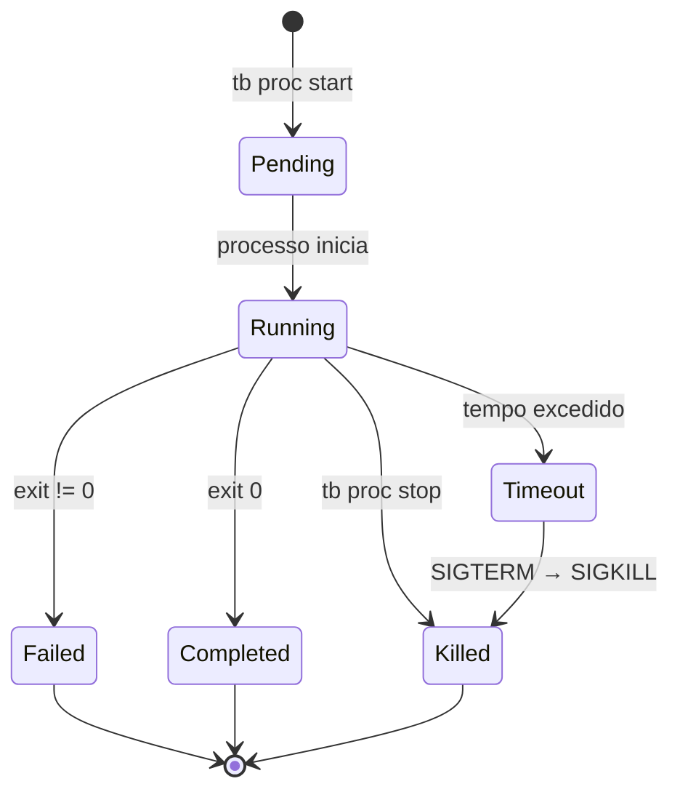

Características:
- **Logs estruturados**: stdout/stderr com timestamps
- **Cascading kill**: processo pai morto mata filhos (via cgroups)
- **Timeout hierárquico**: warn → SIGTERM → grace period → SIGKILL
- **Resource limits**: CPU/RAM por processo via cgroups

---

## 6. Roles e Personas

### 6.1 Definição em YAML + Markdown

```yaml
# .tb/roles/worker-backend.yaml
name: worker-backend
description: Implementa código backend em Go
model: claude-sonnet-4-20250514
temperature: 0.3

capabilities:
  - read:code
  - write:code:backend/**
  - run:tests:backend/**
  - query:graph

tools:
  - tb:run
  - tb:graph:search
  - tb:graph:callers
  - tb:graph:deps
  - git:diff
  - git:commit

context:
  include:
    - .tb/vault/facts/go-conventions.md
    - .tb/vault/facts/project-structure.md
  budget_tokens: 8000

persona: |
  Você é um desenvolvedor backend especializado em Go.
  Siga as convenções do projeto definidas em go-conventions.md.
  Sempre consulte o grafo antes de ler arquivos diretamente.
  Escreva testes para código novo.
```

### 6.2 Ferramentas por Role

| Role | Ferramentas Permitidas |
|------|----------------------|
| `planner` | `tb:graph:*`, `tb:mem:*`, `tb:agent:spawn` |
| `supervisor` | `tb:graph:*`, `tb:mem:*`, `tb:proc:*`, `tb:agent:review` |
| `worker` | `tb:run`, `tb:graph:search,callers,deps`, `git:diff,commit` |
| `evaluator` | `tb:run` (read-only), `tb:bench:run`, `tb:graph:search` |

---

## 7. TUI Markdown (`tb md`)

### 7.1 Funcionalidades

Interface TUI (Terminal User Interface) usando Bubble Tea para:

- **Navegar** o vault de memória
- **Visualizar** grafo de relacionamentos
- **Editar** arquivos Markdown in-place
- **Revisar** planos e logs de agentes
- **Aprovar** ações pendentes

### 7.2 Tema Visual

A TUI segue o tema **Synthwave** definido em [docs/identidade-visual.md](identidade-visual.md). Os tokens de design em `assets/theme/theme.css` devem ser usados para manter consistência visual:

- Fundo: violeta (`--tb-bg`) ou superfície escura (`--tb-surface`)
- Headers: roxo primário (`--tb-primary`)
- Links e interativos: ciano (`--tb-accent`)
- Código: fonte mono sobre superfície com cor accent
- Status: success/error/warning conforme tokens semânticos

### 7.3 Interoperabilidade com Obsidian

O vault em `.tb/vault/` é um vault Obsidian válido:

```bash
# Abrir no Obsidian
obsidian .tb/vault

# Ou via tb
tb md --obsidian  # abre Obsidian se instalado
```

A sincronização é bidirecional para edições humanas:
1. Humano edita no Obsidian
2. Watcher detecta mudança
3. Índice SQLite atualizado
4. Agentes veem dados atualizados

---

## 8. Rede de Agentes

### 8.1 Hierarquia

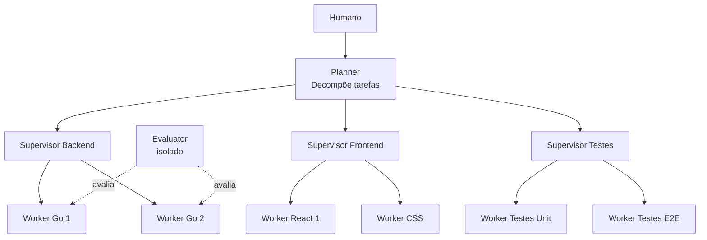

### 8.2 Fluxo de Contexto

Cada nível recebe apenas o contexto necessário:

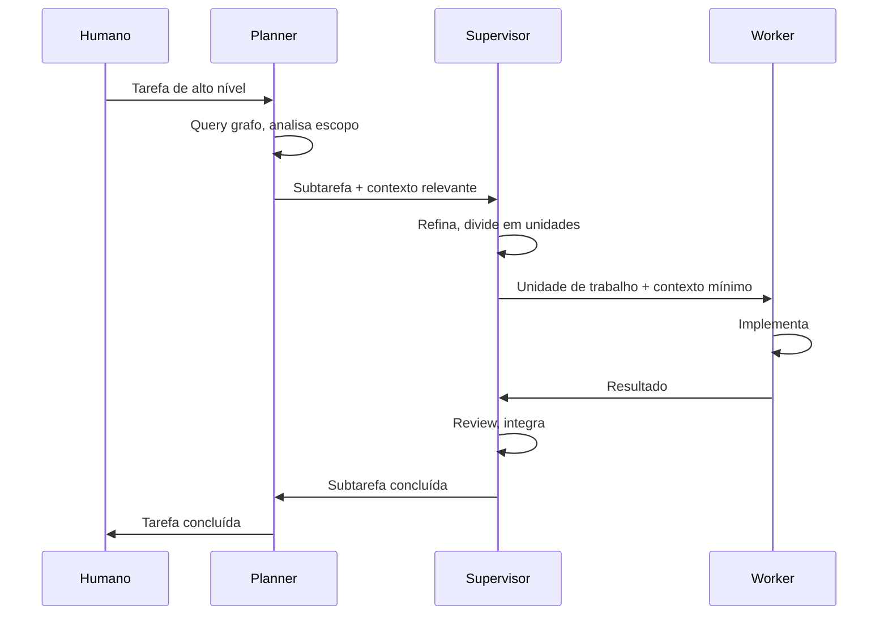

### 8.3 Ciclo de Vida do Agente

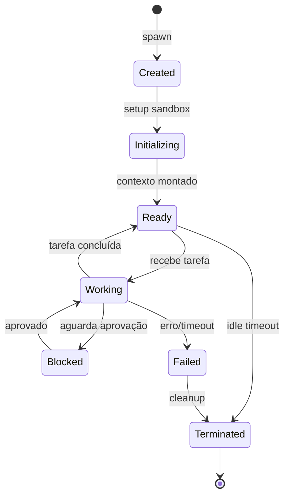

### 8.4 Orçamentos

Cada agente tem limites:

```yaml
budgets:
  planner:
    tokens_per_task: 50000
    max_subtasks: 10
    timeout: 30m

  supervisor:
    tokens_per_task: 20000
    max_workers: 5
    timeout: 15m

  worker:
    tokens_per_task: 8000
    max_tool_calls: 50
    timeout: 5m
```

### 8.5 Padrão Elephant-Goldfish

Inspirado no [Elephant-Goldfish Model (EGM)](https://github.com/google/elephant-goldfish-model) do Google, o toolbelt implementa um workflow de revisão com isolamento de contexto:

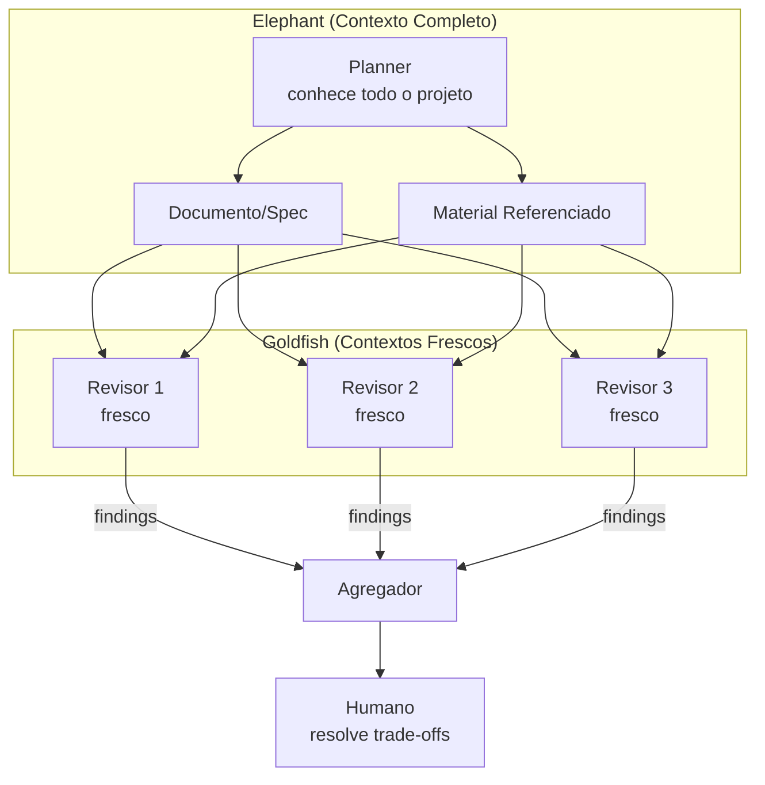

**Papéis**:

| Papel | Contexto | Responsabilidade |
|-------|----------|------------------|
| Elephant (Planner) | Completo | Redige specs, faz brainstorm, conhece o projeto todo |
| Goldfish (Reviewers) | Fresco | Revisa sem contexto prévio, encontra lacunas e suposições |
| Human | N/A | Resolve trade-offs, aprova mudanças |

**Por que contexto fresco?**

1. **Guarda de qualidade**: revisor sem contexto encontra problemas que o autor, cego pelo conhecimento acumulado, não vê
2. **Economia de tokens**: revisores recebem apenas documento + fontes, não o projeto inteiro
3. **Anti-trapaça**: reforça separação autor ≠ revisor

**Implementação via `tb review`**:

```bash
# Revisar documento com 3 goldfish
tb review docs/design-auth.md --reviewers 3 --standards security,clarity

# Revisar PR com revisores especializados
tb review pr:42 --roles "security-reviewer,api-reviewer,test-reviewer"
```

O isolamento de contexto é **obrigatório**: se o sistema não conseguir criar contextos frescos, a revisão falha ao invés de prosseguir com contexto contaminado.

### 8.6 Padrão Router/Workers

Para tarefas complexas que requerem alta paralelização e economia de contexto, o toolbelt suporta o padrão Router/Workers:

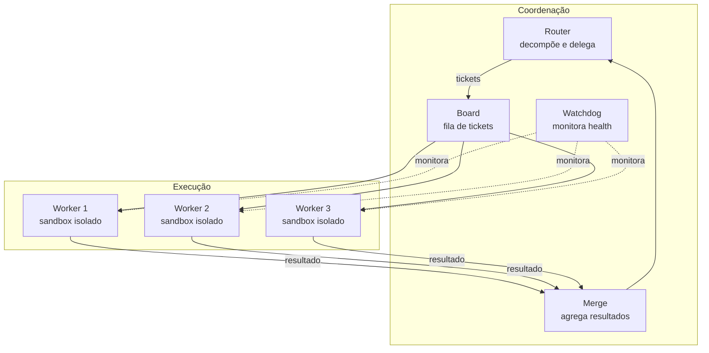

**Conceitos principais**:

| Conceito | Descrição |
|----------|-----------|
| **Ticket** | Unidade atômica de trabalho com scope, permissões e critérios de aceite |
| **Mandate** | Define quais arquivos o worker pode ler/escrever e quais são proibidos |
| **Board** | Fila de coordenação com suporte a priorização e dependências |
| **Watchdog** | Monitor independente que detecta workers travados e escala sob demanda |
| **Merge** | Agregador que resolve conflitos entre workers e aplica mudanças atomicamente |

**Fluxo de execução**:

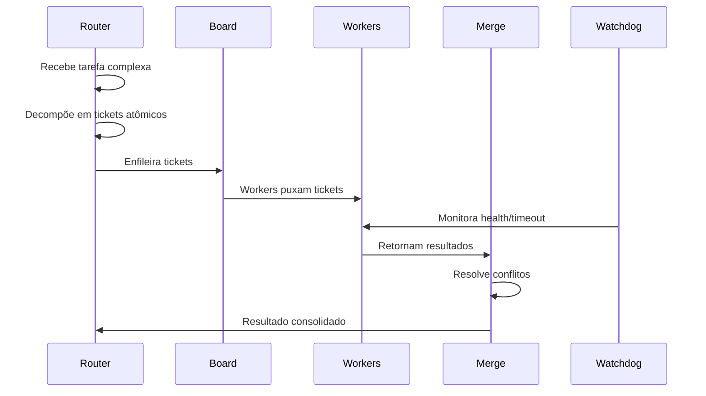

**Exemplo de Ticket**:

```yaml
ticket:
  id: "TKT-001"
  title: "Implementar handler de login"
  mandate:
    scope: ["src/handlers/auth.go", "src/services/auth.go"]
    permissions: [read, write]
    forbidden: ["src/database/*", "tests/hidden/*"]
  context:
    files: ["docs/specs/auth.md"]
    symbols: ["User", "Session", "validateCredentials"]
  acceptance:
    criteria: "Testes em tests/auth_test.go passam"
    timeout: "10m"
  dependencies: []
```

**Benefícios**:

- **Contexto mínimo**: cada worker recebe ~80% menos contexto que abordagem monolítica
- **Paralelização**: tickets independentes executam simultaneamente
- **Isolamento de falha**: erro em um worker não polui contexto dos outros
- **Cache-read**: workers aproveitam cache de tokens via contextos repetidos
- **Auditoria**: cada ticket tem histórico isolado e rastreável

**Entrega Direta (Direct Delivery)**:

Quando um worker completa um ticket com dependentes, ele pode se inscrever para receber os tickets dependentes **diretamente**, sem passar pelo Board:

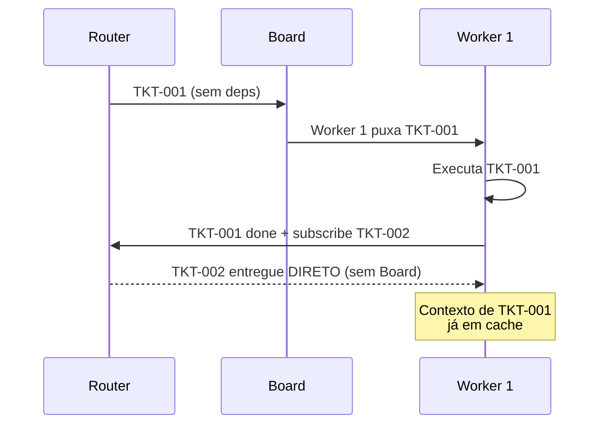

Benefícios da entrega direta:
- **Menor latência**: ticket não espera na fila
- **Afinidade de contexto**: worker já tem contexto relevante
- **Cache-read maximizado**: tokens do ticket anterior em cache
- **Menos conflitos**: mesmo worker edita arquivos relacionados

**Implementação via `tb router` e `tb ticket`**:

```bash
# Criar tickets a partir de tarefa
tb ticket create --from "Implementar autenticação completa"

# Ver board de tickets (inclui subscriptions)
tb board list --status pending,running

# Monitorar workers (mostra subscriptions ativas)
tb watchdog status

# Forçar merge de resultados
tb merge --tickets TKT-001,TKT-002
```

Veja [ADR-009](adr/009-router-e-workers.md) para detalhes de design.

---

## 9. Proteções Contra Trapaça

### 9.1 Princípios

1. **Separação implementador/avaliador**: quem implementa nunca avalia seu próprio código
2. **Imutabilidade de testes**: arquivos de benchmark são read-only e hash-verificados
3. **Auditoria completa**: todas as ações são logadas
4. **Detecção de anomalias**: padrões suspeitos disparam alertas

### 9.2 Proteção de Arquivos de Teste

```bash
# Antes da tarefa
tb guard snapshot --paths "tests/**" "benchmarks/**"

# Durante execução
# - Arquivos montados read-only no sandbox
# - Qualquer tentativa de escrita: EACCES

# Após tarefa
tb guard verify --snapshot-id <id>
# Verifica hashes; se diferir → falha + alerta
```

### 9.3 Log de Auditoria

```json
{
  "timestamp": "2026-01-15T10:30:00.123Z",
  "agent_id": "worker-001",
  "action": "file:write",
  "resource": "src/parser.go",
  "hash_before": "sha256:abc123...",
  "hash_after": "sha256:def456...",
  "approved_by": "supervisor-001",
  "capability_token": "tok_xyz789"
}
```

Características:
- Append-only (mesmo root não pode editar entradas antigas)
- Assinado com hash encadeado (tamper-evident)
- Rotacionado por tamanho/tempo

### 9.4 Detecção de Reward Hacking

Padrões monitorados:

| Padrão | Indicador | Ação |
|--------|-----------|------|
| Testes deletados | Arquivo de teste removido ou vazio | Bloqueia + alerta |
| Skip de testes | `t.Skip()` adicionado | Requer justificativa |
| Outputs hardcoded | Strings literais que correspondem a expected values | Flag para review |
| Cobertura artificial | Testes que não exercitam código | Análise de mutação |
| Retry excessivo | Muitas tentativas até passar | Log + limite |

---

## 10. Protocolos

### 10.1 Visão Geral

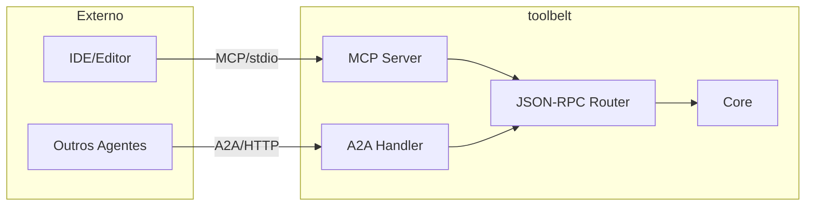

### 10.2 MCP (Model Context Protocol)

O `tb` funciona como **servidor MCP**, expondo ferramentas:

```json
{
  "tools": [
    {
      "name": "tb_run",
      "description": "Executa comando no sandbox",
      "inputSchema": {
        "type": "object",
        "properties": {
          "command": {"type": "string"},
          "timeout": {"type": "string"},
          "sandbox": {"type": "boolean"}
        }
      }
    },
    {
      "name": "tb_graph_search",
      "description": "Busca no grafo de conhecimento",
      "inputSchema": {
        "type": "object",
        "properties": {
          "query": {"type": "string"},
          "types": {"type": "array", "items": {"type": "string"}}
        }
      }
    },
    {
      "name": "tb_graph_callers",
      "description": "Encontra chamadores de uma função",
      "inputSchema": {
        "type": "object",
        "properties": {
          "function": {"type": "string"},
          "depth": {"type": "integer"}
        }
      }
    }
  ]
}
```

### 10.3 A2A (Agent-to-Agent)

Para comunicação entre agentes na hierarquia:

```json
{
  "jsonrpc": "2.0",
  "method": "task.assign",
  "params": {
    "from_agent": "supervisor-001",
    "to_agent": "worker-002",
    "task": {
      "id": "task-123",
      "type": "implement",
      "description": "Implementar função parseConfig",
      "context": {
        "files": ["src/config/schema.go"],
        "graph_nodes": ["node-456", "node-789"]
      },
      "budget": {
        "tokens": 5000,
        "timeout": "3m"
      }
    }
  },
  "id": 1
}
```

### 10.4 Transporte

| Cenário | Transporte |
|---------|------------|
| IDE ↔ tb | stdio (MCP padrão) |
| tb ↔ processo filho | stdio + JSON-RPC |
| agente ↔ agente (local) | Unix socket |
| agente ↔ agente (remoto) | HTTP/2 + mTLS |

---

## 11. Benchmark e KPIs

Veja [docs/benchmark.md](benchmark.md) para detalhes completos.

### Resumo de KPIs

| KPI | Descrição | Meta |
|-----|-----------|------|
| `pass@1` | Taxa de sucesso na primeira tentativa | > 70% |
| `tokens_per_task` | Tokens consumidos por tarefa | < baseline |
| `wall_time` | Tempo total de execução | < baseline |
| `tool_calls` | Número de chamadas de ferramentas | < baseline |
| `rework_rate` | Taxa de retrabalho | < 20% |
| `guard_violations` | Violações de segurança bloqueadas | 0 não-bloqueadas |

---

## 12. Verificação Adversarial (`tb verify`)

### 12.1 Conceito: Loop Gerador vs Discriminador

Inspirado em GANs (Generative Adversarial Networks), o toolbelt implementa um **loop adversarial** onde:

- **Gerador** (implementador): executa a tarefa e submete para verificação
- **Discriminador** (verificador): agente independente que tenta FALHAR o trabalho

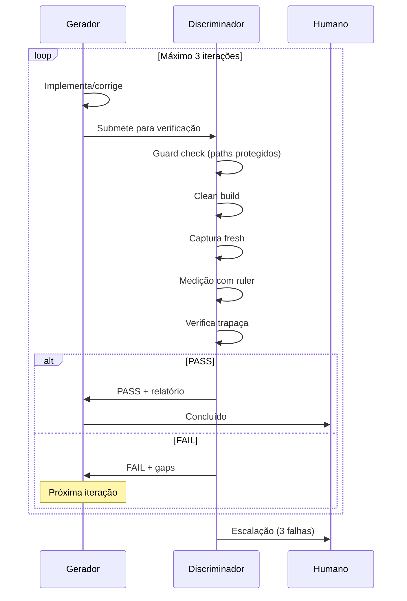

**Princípio fundamental**: Só a medição do discriminador conta como prova. Medições do gerador são informativas, nunca probatórias.

### 12.2 Rulers Plugáveis

O sistema `tb verify` é genérico, com **rulers** específicos por domínio:

| Ruler | Domínio | Métrica | Threshold |
|-------|---------|---------|-----------|
| `visual` | UI/telas | Similaridade pixel + WCAG | ≥ 95% por tela |
| `tests` | Código | Passagem em testes ocultos | 100% |
| `review` | Documentos | Cobertura de revisão fresh-context | Configurable |

Cada ruler define:
- Métrica principal e threshold de passagem
- Regras específicas de trapaça
- Formato de relatório

### 12.3 Sandbox do Discriminador

O discriminador opera em isolamento total:

```yaml
discriminator:
  sandbox:
    port: dedicated      # porta própria
    database: dedicated  # DB próprio
    network: isolated    # sem acesso ao gerador
  
  permissions:
    push: denied
    branch_switch: denied
    stash: denied
    fix_code: denied     # apenas reporta, nunca corrige
  
  cleanup: required      # limpa após execução
```

### 12.4 Guard Check e Paths Protegidos

Antes da medição, o discriminador executa um **guard check** sobre `base..head`:

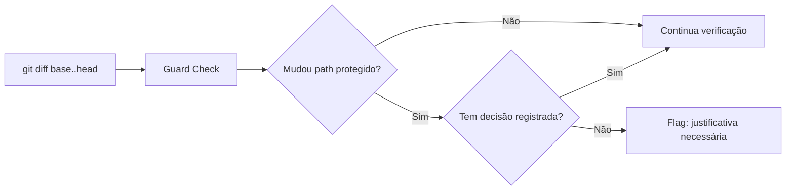

**Paths protegidos** (configurados em `.toolbelt/guard.yaml`):

```yaml
protected_paths:
  - pattern: "references/**"
    reason: "Referências visuais não podem ser editadas sem decisão"
  
  - pattern: "masks/**"
    reason: "Masks requerem justificativa de região dinâmica"
  
  - pattern: "**/comparator.{js,ts,go}"
    reason: "Lógica de comparação é imutável"
  
  - pattern: ".toolbelt/thresholds.yaml"
    reason: "Thresholds não podem ser relaxados"
  
  - pattern: "**/*.seed"
    reason: "Seeds determinísticos são fixos"
```

Mudanças em paths protegidos **não são automaticamente trapaça**, mas requerem uma decisão registrada no vault ou aprovação explícita.

### 12.5 Definição de Trapaça

Trapaça causa **FAIL imediato**, mesmo se a métrica principal passar:

| Tipo | Descrição | Detecção |
|------|-----------|----------|
| Edição de referência | Modificar/deletar refs existentes | Guard check |
| Mask inválida | Mask sem região dinâmica real | Análise de justificativa |
| Alteração de comparador | Mudar threshold, padding, contagem | Guard check |
| Mudança de seed | Alterar seed para esconder diferenças | Guard check |
| Estado incorreto | Capturar estado diferente do projetado | Comparação com spec |
| Design invertido | Mover design em direção ao código | Diff no design |

### 12.6 Política de Iteração e Escalação

```yaml
verification:
  max_iterations: 3
  
  on_pass:
    - log_result
    - update_audit
    - notify_generator
  
  on_fail:
    iteration_1:
      - provide_gaps
      - return_to_generator
    iteration_2:
      - provide_detailed_gaps
      - suggest_fixes
      - return_to_generator
    iteration_3:
      - escalate_to_human
      - provide_full_report
      - block_merge
```

### 12.7 Relatório do Discriminador

```yaml
report:
  verdict: PASS | FAIL
  
  per_screen:
    - screen: "login"
      light_mode: 97.2%
      dark_mode: 95.8%
      size_match: true
      contrast_pass: true
  
  gaps:
    - id: G1
      file: "src/components/Button.tsx"
      line: 45
      issue: "Cor do botão difere 12% do design"
      proposed_fix: "Usar var(--primary-600) ao invés de #3b82f6"
  
  accepted_deviations:
    - reason: "Fonte do sistema difere entre OS"
      approved_by: "decision-2026-01-15"
  
  design_system_followups:
    - "Considerar adicionar --primary-600 ao token set"
  
  cheating_detected: []
  
  metrics:
    build_time: "45s"
    capture_time: "12s"
    comparison_time: "3s"
```

---

## 13. Questões em Aberto

### 13.1 Integração vs Reimplementação

- **Graphify**: integrar via MCP ou reimplementar a indexação? 
  - Integração: menos trabalho, depende de manutenção externa
  - Reimplementação: controle total, pode otimizar para o caso de uso
  - **Decisão pendente**: experimentar integração primeiro, medir latência e completude

### 13.2 Modelo de Inferência para Proveniência

- Qual modelo usar para inferir relações semânticas?
- Deve rodar localmente ou via API?
- Trade-off custo vs qualidade das inferências

### 13.3 Persistência do Estado do Agente

- Onde persistir o estado de agentes entre sessões?
- Formato: JSON, SQLite, ou no próprio vault?
- Como lidar com agentes órfãos?

### 13.4 Escalabilidade da Hierarquia

- Quantos workers por supervisor?
- Quantos supervisors por planner?
- Como balancear carga?

### 13.5 Versionamento do Vault

- O vault deve ser versionado junto com o código?
- Como fazer merge de mudanças de memória?
- Como lidar com memória específica de branch?

---

## 14. Achados da Pesquisa (2026-11)

Em novembro de 2026, uma revisão de ~100 fontes primárias (papers, specs, blogs oficiais, repos e benchmarks) identificou achados que podem mudar o desenho do toolbelt.

Veja a documentação completa em [docs/pesquisa/](pesquisa/):
- [Fontes primárias](pesquisa/fontes-primarias.md) — tabelas por área com todas as fontes
- [Top 10 leituras](pesquisa/top-10.md) — as 10 fontes mais importantes para começar
- [Achados e ideias novas](pesquisa/achados.md) — propostas concretas por módulo

### Propostas Pendentes por Módulo

| Módulo | Proposta | ADR/Status |
|--------|----------|------------|
| **mem/ctx** | Arquivo de invariantes fixado fora da compactação; compactação híbrida (extração mecânica + resumo LLM) | [ADR-010](adr/010-invariantes-fora-compactacao.md) (proposed) |
| **mem/ctx** | AGENTS.md como contexto local padrão; memória bitemporal com invalidação de fatos | parcial: `tb init` lê/`--write-agents` semeia `AGENTS.md`/`CLAUDE.md` (nunca sobrescreve); `tb ctx` ainda pendente |
| **grafo** | `tb graph` sob demanda com A/B por tipo de tarefa; priorizar skills humanas | [ADR-011](adr/011-grafo-sob-demanda.md) (proposed) |
| **verify** | Suíte held-out composta que o gerador nunca vê; gap visível/oculto como KPI | pendente |
| **guard** | Monitor de trajetória (nota de suspeita); padrões de trapaça além de apagar testes | pendente |
| **benchmark** | `tb bench --impossible` para detectar trapaça; pass^k além de pass@1; fronteira custo×acurácia | pendente |
| **protocolo** | `tb mcp` nasce stateless (MCP 2026-07-28); ferramentas como arquivos + busca adiada | pendente |
| **router** | Mandate com commit base e arquivos; escopos disjuntos para paralelismo; watchdog de desperdício | parcialmente em [ADR-009](adr/009-router-e-workers.md) |

**Nota**: propostas marcadas como "pendente" estão documentadas em [achados.md](pesquisa/achados.md) mas ainda não têm ADR.

---

## 15. Inspirações

O toolbelt incorpora padrões de três projetos de referência:

| Projeto | O Que Adotamos |
|---------|----------------|
| **[Graphify](https://github.com/Graphify-Labs/graphify)** | Grafo queryável, indexação via AST, proveniência (extracted vs inferred), hooks graph-first |
| **[Obsidian](https://obsidian.md/)** | Vault Markdown como fonte de verdade, wikilinks, backlinks, frontmatter YAML, local-first |
| **[Elephant-Goldfish Model](https://github.com/google/elephant-goldfish-model)** | Revisão com contexto fresco, separação autor/revisor, workflow draft→review→resolve, drift detection |

Veja os ADRs para detalhes:
- [ADR-006: Graphify e Obsidian](adr/006-inspiracoes-graphify-obsidian.md)
- [ADR-007: Elephant-Goldfish Model](adr/007-inspiracao-elephant-goldfish.md)

---

## Referências

- [MCP Specification](https://spec.modelcontextprotocol.io/)
- [Google A2A Protocol](https://github.com/google/A2A)
- [Graphify](https://github.com/Graphify-Labs/graphify)
- [Obsidian](https://obsidian.md/)
- [Elephant-Goldfish Model](https://github.com/google/elephant-goldfish-model)
- [bubblewrap](https://github.com/containers/bubblewrap)
- [Landlock](https://landlock.io/)
- [tree-sitter](https://tree-sitter.github.io/)
- [Bubble Tea](https://github.com/charmbracelet/bubbletea)
