🇺🇸 English | [🇧🇷 Português](pt-BR/arquitetura.md)

# toolbelt Architecture (`tb`)

## Overview

`toolbelt` is a set of tools for AI coding agents, unified under a single binary (`tb`) and protocol. The goal is to provide a safe, efficient, and auditable environment for autonomous agents to run development tasks.

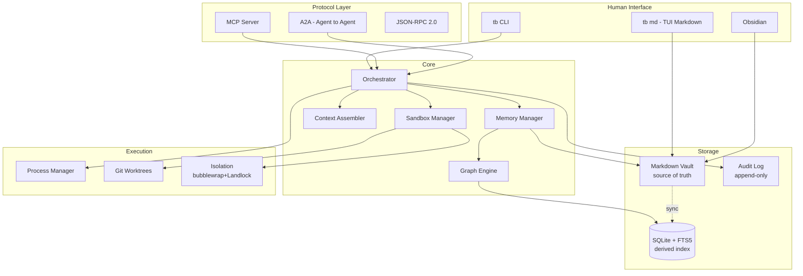

---

## 1. Workspace and Sandbox

### 1.1 Isolation by Worktree

Each agent operates in a dedicated **git worktree**, enabling:

- Parallel work without branch conflicts
- Instant snapshot and rollback via git
- Simple cleanup when the task finishes

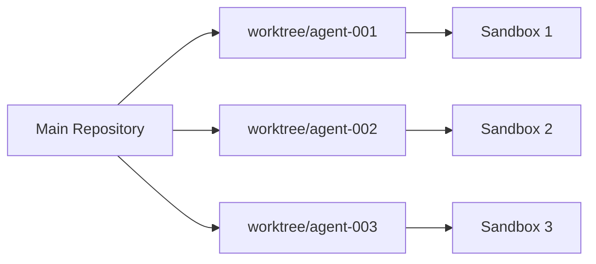

### 1.2 Isolation Layers

| Layer | Technology | Responsibility |
|-------|------------|----------------|
| Filesystem | bubblewrap | Mounts only allowed directories; read-only bind-mount for tests |
| Syscalls | seccomp | Allowed syscall list per task profile |
| Filesystem (runtime) | Landlock | Access restrictions even for child processes |
| Resources | cgroups v2 | CPU, RAM, and execution-time limits |
| Network | netns/bubblewrap | Denied by default; explicit whitelist |

### 1.3 Snapshot and Rollback

Before each task:
1. `git stash --include-untracked` or a temporary commit
2. State hash saved in the audit log
3. Task execution in the sandbox
4. On failure or violation: `git reset --hard` + `git clean -fdx`

---

## 2. Memory vs Context

**Memory** and **context** are distinct concepts:

| Aspect | Memory | Context |
|--------|--------|---------|
| **Definition** | Persistent storage of facts, decisions, summaries, and the graph | What is assembled into the model window for a specific task |
| **Persistence** | Permanent (Markdown vault + SQLite) | Ephemeral (lasts one request) |
| **Size** | Unlimited (grows with the project) | Limited by the token budget |
| **Format** | Markdown + frontmatter + graph | Text serialized for the prompt |

### 2.1 Context Types

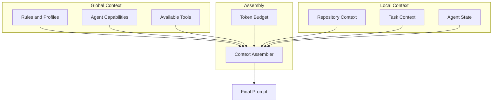

### 2.2 Context Hierarchy

1. **Global**: system rules, user profile, available MCP tools
2. **Repository**: project structure, conventions, main dependencies
3. **Agent**: role/persona, recent history, specific capabilities
4. **Task**: objective, relevant files, graph query results

The **Context Assembler** receives a token budget and prioritizes the most relevant information, truncating or summarizing when needed.

---

## 3. Storage: Markdown Vault + SQLite/FTS5

### 3.1 Markdown Vault (Source of Truth)

Inspired by Obsidian, memory is a vault of Markdown files:

```
.tb/
├── vault/
│   ├── facts/
│   │   ├── projeto-estrutura.md
│   │   └── decisoes-arquitetura.md
│   ├── agents/
│   │   ├── agent-001-log.md
│   │   └── agent-002-log.md
│   ├── summaries/
│   │   └── sprint-2024-01.md
│   └── code/
│       ├── modules/
│       │   └── auth-module.md
│       └── functions/
│           └── parse-config.md
├── index.db          # derived SQLite
└── audit.log         # Log append-only
```

Each file uses:
- **YAML frontmatter**: structured metadata (type, tags, date, provenance)
- **Wikilinks**: `[[other-file]]` for relationships
- **Tags**: `#decision`, `#fact`, `#inferred`
- **Backlinks**: calculated automatically

Example file:

```markdown
---
type: fact
tags: [architecture, database]
created: 2026-01-15T10:30:00Z
source: extracted
confidence: high
---

# Decision: SQLite for Storage

The project uses SQLite as its main database.

## Rationale
- Simple deploy (single file)
- Excellent read performance
- FTS5 for full-text search

## Relationships
- Implemented in: [[database-module]]
- Decided in: [[adr-003-sqlite-fts5]]
- Affects: [[config-schema]], [[migration-system]]
```

### 3.2 SQLite + FTS5 (Derived Index)

SQLite is a **derived index**, rebuilt from the vault and the code:

```sql
-- Graph nodes
CREATE TABLE nodes (
    id TEXT PRIMARY KEY,
    type TEXT NOT NULL,           -- 'file', 'function', 'class', 'fact', 'decision'
    path TEXT,                    -- path in the vault or in code
    title TEXT,
    content TEXT,
    source TEXT NOT NULL,         -- 'vault', 'code', 'inferred'
    confidence REAL DEFAULT 1.0,  -- 0.0-1.0 for inferred data
    created_at TEXT,
    updated_at TEXT,
    metadata JSON
);

-- Full-text index
CREATE VIRTUAL TABLE nodes_fts USING fts5(
    title, content,
    content='nodes',
    content_rowid='rowid'
);

-- Graph edges
CREATE TABLE edges (
    id INTEGER PRIMARY KEY,
    source_id TEXT NOT NULL,
    target_id TEXT NOT NULL,
    type TEXT NOT NULL,           -- 'calls', 'imports', 'references', 'implements', 'links_to'
    source TEXT NOT NULL,         -- 'extracted', 'inferred', 'manual'
    confidence REAL DEFAULT 1.0,
    metadata JSON,
    FOREIGN KEY (source_id) REFERENCES nodes(id),
    FOREIGN KEY (target_id) REFERENCES nodes(id)
);

-- Indexes for fast queries
CREATE INDEX idx_edges_source ON edges(source_id);
CREATE INDEX idx_edges_target ON edges(target_id);
CREATE INDEX idx_edges_type ON edges(type);
CREATE INDEX idx_nodes_type ON nodes(type);
CREATE INDEX idx_nodes_path ON nodes(path);

-- Useful views
CREATE VIEW callers AS
SELECT e.source_id as caller, e.target_id as callee, e.confidence
FROM edges e WHERE e.type = 'calls';

CREATE VIEW dependencies AS
SELECT e.source_id as dependent, e.target_id as dependency, e.confidence
FROM edges e WHERE e.type = 'imports';
```

### 3.3 Vault → SQLite Sync

The sync direction is **unidirectional**: vault → SQLite.

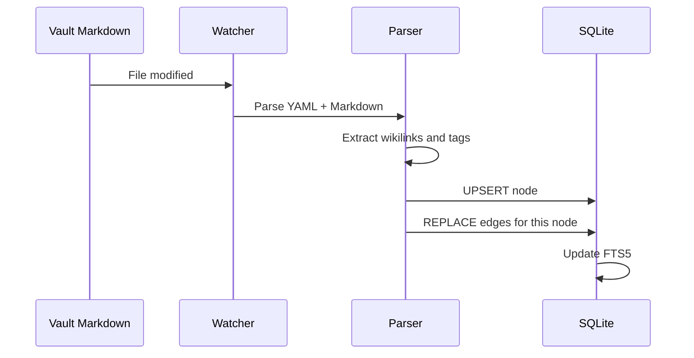

**Conflict resolution**: the vault always wins. If SQLite diverges (corruption, manual edit), the `tb graph rebuild` command rebuilds everything.

### 3.4 Code Indexing with Provenance

Inspired by Graphify and reimplemented in toolbelt ([ADR-014](adr/014-graphify-reimplementacao.md)), `tb graph` indexes code with `go/ast` (Go) and conservative regex extractors (TS/JS, Python, Rust, frameworks). tree-sitter remains a future option, not implemented:

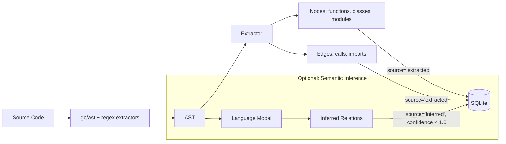

**Edge provenance**:
- `extracted`: derived directly from the AST (high confidence)
- `inferred`: deduced by LLM or heuristics (variable confidence)
- `manual`: inserted by a human via the vault

### 3.5 Queries for Agents

The graph exposes queries that save tokens:

```bash
# Who calls this function?
tb graph callers --function "parseConfig" --depth 2

# What are this module's dependencies?
tb graph deps --module "auth" --transitive

# What is the impact of changing this file?
tb graph impact --file "src/config/parser.go"

# Semantic search
tb graph search "JWT authentication"
```

**Hooks for agents**: before reading raw files, the agent should query the graph:

```
1. Receives task: "Fix bug in the config parser"
2. tb graph search "parser config" → finds relevant nodes
3. tb graph callers --function "parseConfig" → learns who uses it
4. tb graph impact --file "parser.go" → assesses scope
5. Only then reads the specific files needed
```

This drastically reduces the number of tokens consumed reading files.

---

## 4. Security

### 4.1 Threat Model

| Threat | Mitigation |
|--------|------------|
| Sandbox escape | Multiple layers (bubblewrap + Landlock + seccomp) |
| Secret access | Variables injected only for authorized tools; never in the prompt |
| Test modification | Read-only test files + verified hash |
| Data exfiltration | Network denied by default; explicit whitelist |
| Privilege escalation | Minimal capabilities; capability tokens per action |
| Reward hacking | Implementer ≠ evaluator; suspicious-pattern detection |

### 4.2 Permissions by Capability

Each role has a set of capabilities:

```yaml
roles:
  worker:
    capabilities:
      - read:code
      - write:code
      - run:tests
      - query:graph
    denied:
      - write:tests
      - delete:*
      - network:*

  supervisor:
    capabilities:
      - read:*
      - write:code
      - approve:worker_changes
      - query:graph
    denied:
      - delete:*
      - network:external

  planner:
    capabilities:
      - read:*
      - write:plans
      - spawn:supervisor
      - query:graph
      - network:internal
```

### 4.3 Capability Tokens for Destructive Actions

Dangerous actions require explicit capability tokens:

```go
type CapabilityToken struct {
    Action    string    // "delete:file", "network:external"
    Resource  string    // path or pattern
    GrantedBy string    // who approved
    ExpiresAt time.Time
    Hash      string    // signature for verification
}
```

The flow:
1. Agent requests a destructive action
2. System generates a pending token
3. Human (or authorized supervisor) approves
4. Token is signed and has a short validity
5. Action executes presenting the token

### 4.4 Secret Handling

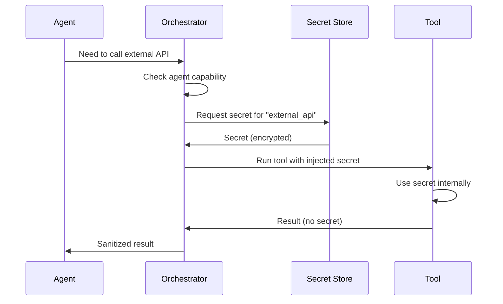

Secrets never appear:
- In the model prompt
- In logs
- In vault memory
- In responses to the agent

---

## 5. Scripts and Processes

### 5.1 `tb run` and `tb proc` Commands

```bash
# One-shot run with timeout
tb run --timeout 30s "go test ./..."

# Long-running process with logs
tb proc start --name "dev-server" --log /tmp/dev.log "npm run dev"
tb proc list
tb proc logs dev-server --follow
tb proc stop dev-server

# Sandboxed run
tb run --sandbox --allow-net "localhost:8080" "curl localhost:8080/health"
```

### 5.2 Process Management

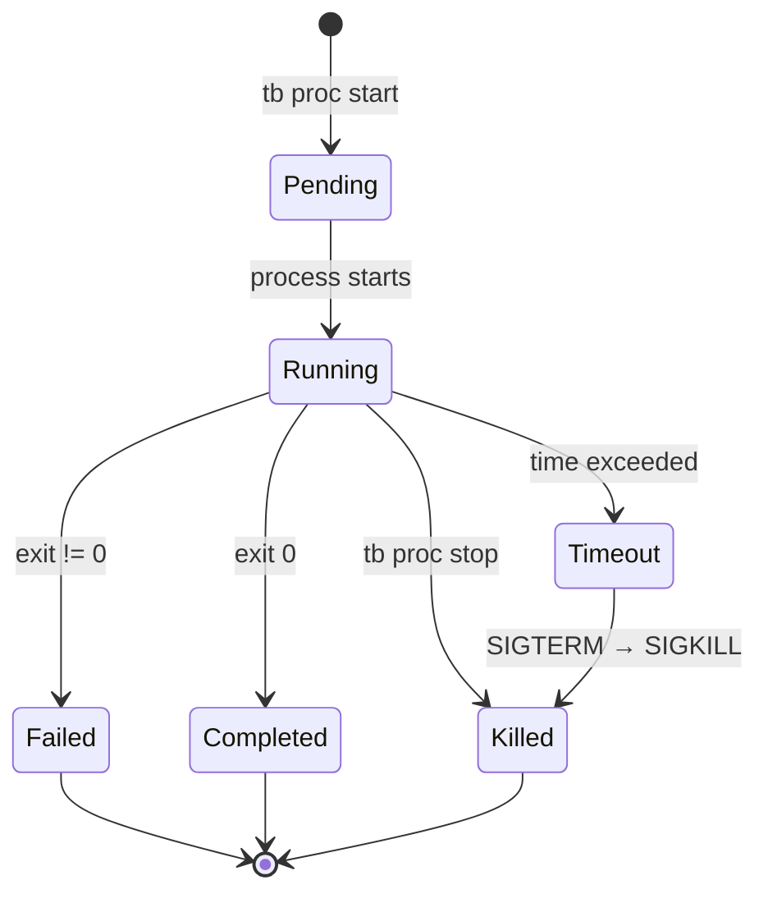

Characteristics:
- **Structured logs**: stdout/stderr with timestamps
- **Cascading kill**: killing the parent kills children (via cgroups)
- **Hierarchical timeout**: warn → SIGTERM → grace period → SIGKILL
- **Resource limits**: CPU/RAM per process via cgroups

---

## 6. Roles and Personas

### 6.1 Definition in YAML + Markdown

```yaml
# .tb/roles/worker-backend.yaml
name: worker-backend
description: Implements Go backend code
model: claude-sonnet-4-20250514
temperature: 0.3

capabilities:
  - read:code
  - write:code:backend/**
  - run:tests:backend/**
  - query:graph

tools:
  - tb:run
  - tb:graph:search
  - tb:graph:callers
  - tb:graph:deps
  - git:diff
  - git:commit

context:
  include:
    - .tb/vault/facts/go-conventions.md
    - .tb/vault/facts/project-structure.md
  budget_tokens: 8000

persona: |
  You are a backend developer specialized in Go.
  Follow the project conventions defined in go-conventions.md.
  Always query the graph before reading files directly.
  Write tests for new code.
```

### 6.2 Tools by Role

| Role | Allowed Tools |
|------|---------------|
| `planner` | `tb:graph:*`, `tb:mem:*`, `tb:agent:spawn` |
| `supervisor` | `tb:graph:*`, `tb:mem:*`, `tb:proc:*`, `tb:agent:review` |
| `worker` | `tb:run`, `tb:graph:search,callers,deps`, `git:diff,commit` |
| `evaluator` | `tb:run` (read-only), `tb:bench:run`, `tb:graph:search` |

---

## 7. TUI Markdown (`tb md`)

### 7.1 Features

Terminal User Interface (TUI) using Bubble Tea to:

- **Navigate** the memory vault
- **Visualize** the relationship graph
- **Edit** Markdown files in-place
- **Review** agent plans and logs
- **Approve** pending actions

### 7.2 Visual Theme

The TUI follows the **Synthwave** theme defined in [docs/identidade-visual.md](identidade-visual.md). Design tokens in `assets/theme/theme.css` should be used to keep visual consistency:

- Background: violet (`--tb-bg`) or dark surface (`--tb-surface`)
- Headers: primary purple (`--tb-primary`)
- Links and interactive elements: cyan (`--tb-accent`)
- Code: mono font on surface with accent color
- Status: success/error/warning per semantic tokens

### 7.3 Interoperability with Obsidian

The vault at `.tb/vault/` is a valid Obsidian vault:

```bash
# Open in Obsidian
obsidian .tb/vault

# Or via tb
tb md --obsidian  # opens Obsidian if installed
```

Sync is bidirectional for human edits:
1. Human edits in Obsidian
2. Watcher detects the change
3. SQLite index is updated
4. Agents see updated data

---

## 8. Agent Network

### 8.1 Hierarchy

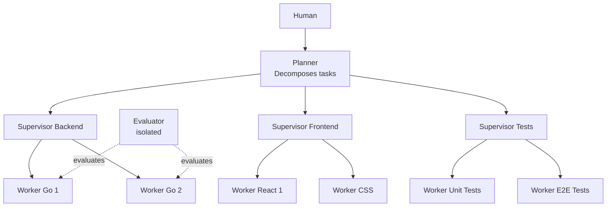

### 8.2 Context Flow

Each level receives only the necessary context:

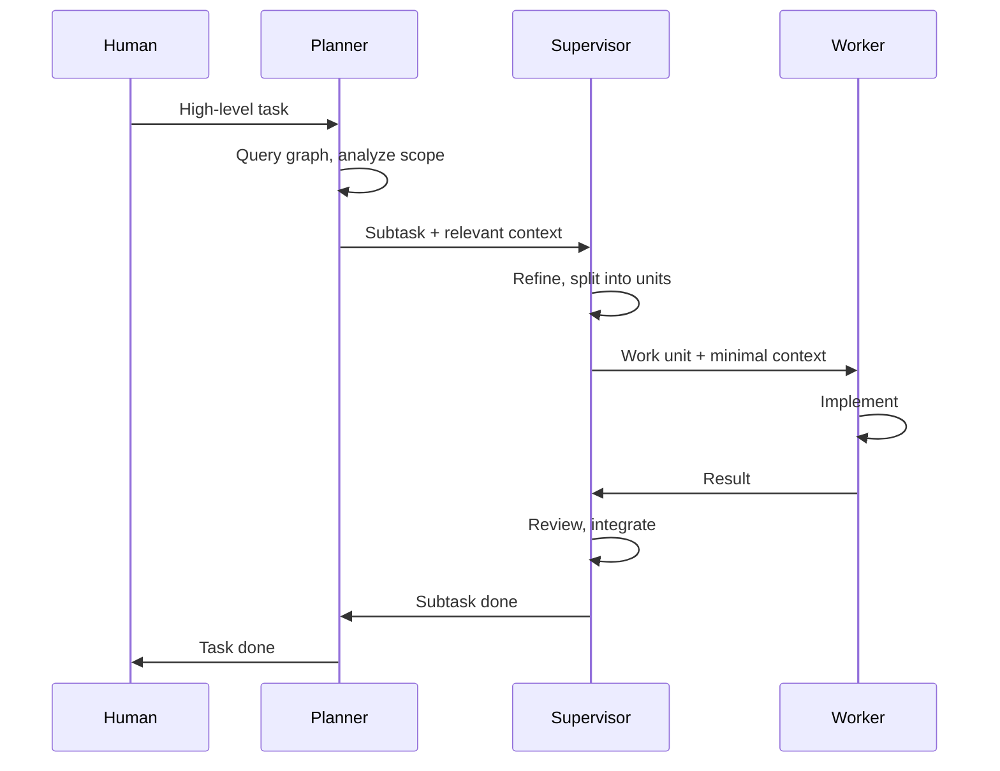

### 8.3 Agent Lifecycle

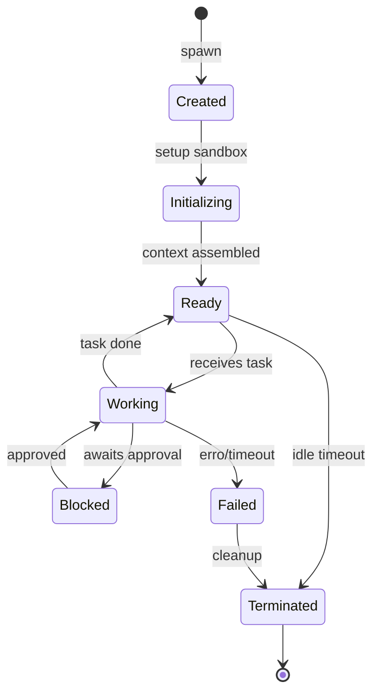

### 8.4 Budgets

Each agent has limits:

```yaml
budgets:
  planner:
    tokens_per_task: 50000
    max_subtasks: 10
    timeout: 30m

  supervisor:
    tokens_per_task: 20000
    max_workers: 5
    timeout: 15m

  worker:
    tokens_per_task: 8000
    max_tool_calls: 50
    timeout: 5m
```

### 8.5 Elephant-Goldfish Pattern

Inspired by Google's [Elephant-Goldfish Model (EGM)](https://github.com/google/elephant-goldfish-model), toolbelt implements a review workflow with context isolation:

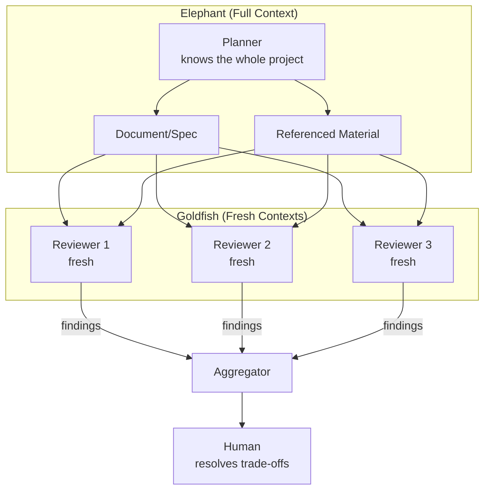

**Roles**:

| Role | Context | Responsibility |
|------|---------|----------------|
| Elephant (Planner) | Full | Drafts specs, brainstorms, knows the whole project |
| Goldfish (Reviewers) | Fresh | Reviews without prior context, finds gaps and assumptions |
| Human | N/A | Resolves trade-offs, approves changes |

**Why fresh context?**

1. **Quality guard**: a reviewer without context finds problems the author, blinded by accumulated knowledge, does not see
2. **Token savings**: reviewers receive only the document + sources, not the whole project
3. **Anti-cheating**: reinforces author ≠ reviewer separation

**Implementation via `tb review`**:

```bash
# Review a document with 3 goldfish
tb review docs/design-auth.md --reviewers 3 --standards security,clarity

# Review a PR with specialized reviewers
tb review pr:42 --roles "security-reviewer,api-reviewer,test-reviewer"
```

Context isolation is **mandatory**: if the system cannot create fresh contexts, the review fails instead of proceeding with contaminated context.

### 8.6 Router/Workers Pattern

For complex tasks that require high parallelization and context savings, toolbelt supports the Router/Workers pattern:

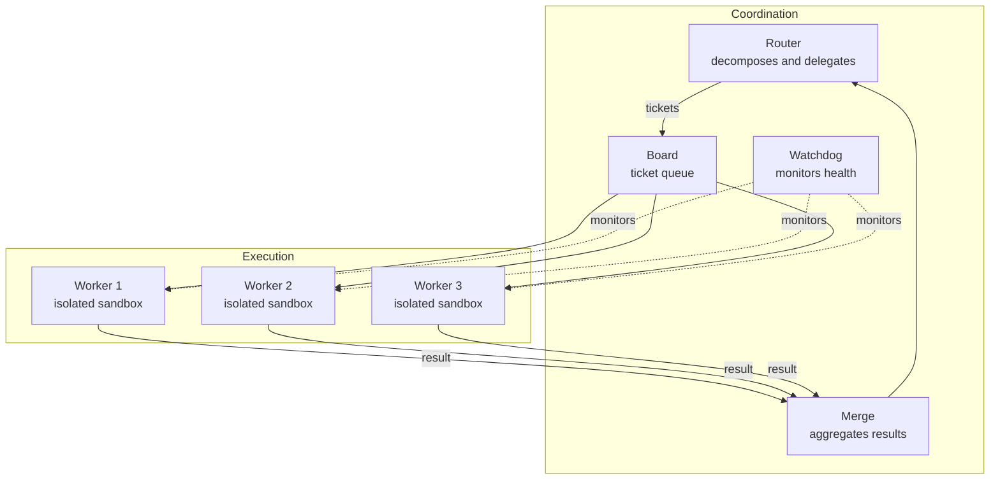

**Main concepts**:

| Concept | Description |
|---------|-------------|
| **Ticket** | Atomic unit of work with scope, permissions, and acceptance criteria |
| **Mandate** | Defines which files the worker may read/write and which are forbidden |
| **Board** | Coordination queue with support for prioritization and dependencies |
| **Watchdog** | Monitor that detects slow/stuck workers and emits alerts (`worker_slow`, `worker_stuck`, `queue_growing`…); runs inside the router loop and does not scale workers automatically |
| **Merge** | Aggregator that resolves conflicts between workers and applies changes atomically |

**Execution flow**:

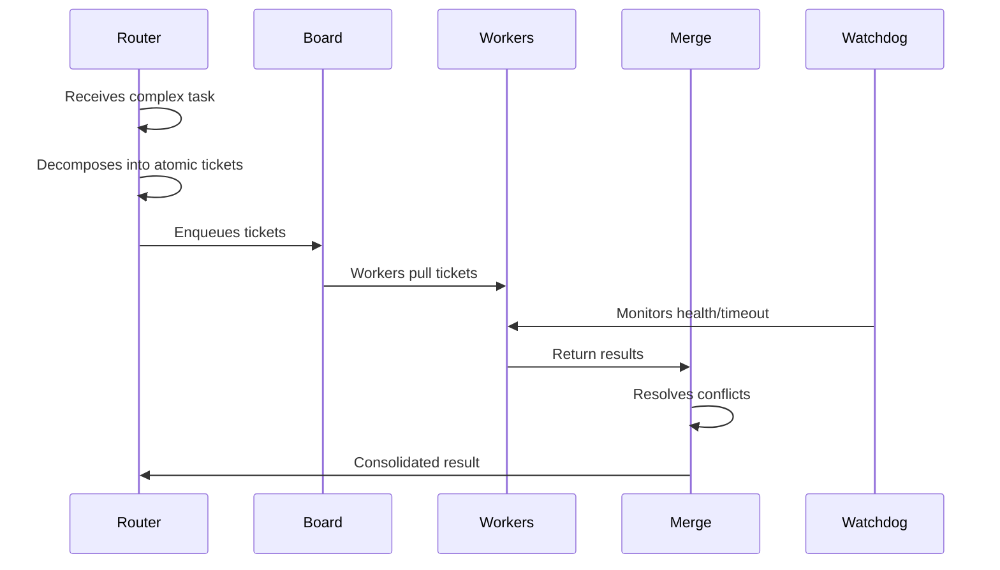

**Ticket example**:

```yaml
ticket:
  id: "TKT-001"
  title: "Implement login handler"
  mandate:
    scope: ["src/handlers/auth.go", "src/services/auth.go"]
    permissions: [read, write]
    forbidden: ["src/database/*", "tests/hidden/*"]
  context:
    files: ["docs/specs/auth.md"]
    symbols: ["User", "Session", "validateCredentials"]
  acceptance:
    criteria: "Tests in tests/auth_test.go pass"
    timeout: "10m"
  dependencies: []
```

**Benefits**:

- **Minimal context**: each worker receives ~80% less context than a monolithic approach
- **Parallelization**: independent tickets run simultaneously
- **Failure isolation**: an error in one worker does not pollute others' context
- **Cache-read**: workers reuse token cache via repeated contexts
- **Audit**: each ticket has an isolated, traceable history

**Direct Delivery**:

When a worker completes a ticket with dependents, it can subscribe to receive dependent tickets **directly**, without going through the Board:


Benefits of direct delivery:
- **Lower latency**: ticket does not wait in the queue
- **Context affinity**: worker already has relevant context
- **Maximized cache-read**: previous ticket tokens in cache
- **Fewer conflicts**: the same worker edits related files

**Implementation via `tb router` and `tb ticket`**:

```bash
# Create tickets (--title or --from rd.md; dependencies via --dep)
tb ticket create --title "Create User model" --scope "src/models/**"
tb ticket create --title "JWT signing" --dep TKT-001

# Run the router (foreground; Ctrl-C returns running -> pending)
tb router run --agent-cmd "my-agent --task-file $TB_TICKET_FILE"

# View the ticket board
tb board list --status pending,running

# Monitor workers (active subscriptions, alert counts)
tb watchdog status

# Merge results (strategies: fail | last_wins)
tb merge TKT-001 TKT-002
```

The router is a **foreground** scheduler (`tb router run`; there is no
`start`/`stop` daemon); the watchdog runs inside the same loop and persists
state and alerts under `.toolbelt/router/`. Details in [cli.md](cli.md).

See [ADR-009](adr/009-router-e-workers.md) for design details.


---

## 9. Anti-Cheating Protections

### 9.1 Principles

1. **Implementer/evaluator separation**: whoever implements never evaluates their own code
2. **Test immutability**: benchmark files are read-only and hash-verified
3. **Full audit**: all actions are logged
4. **Anomaly detection**: suspicious patterns trigger alerts

### 9.2 Test File Protection

```bash
# Before the task
tb guard snapshot --paths "tests/**" "benchmarks/**"

# During execution
# - Files mounted read-only in the sandbox
# - Any write attempt: EACCES

# After the task
tb guard verify --snapshot-id <id>
# Checks hashes; on mismatch → fail + alert
```

### 9.3 Audit Log

```json
{
  "timestamp": "2026-01-15T10:30:00.123Z",
  "agent_id": "worker-001",
  "action": "file:write",
  "resource": "src/parser.go",
  "hash_before": "sha256:abc123...",
  "hash_after": "sha256:def456...",
  "approved_by": "supervisor-001",
  "capability_token": "tok_xyz789"
}
```

Characteristics:
- Append-only (even root cannot edit old entries)
- Signed with a chained hash (tamper-evident)
- Rotated by size/time

### 9.4 Reward Hacking Detection

Monitored patterns:

| Pattern | Indicator | Action |
|---------|-----------|--------|
| Deleted tests | Test file removed or emptied | Block + alert |
| Test skips | `t.Skip()` added | Requires justification |
| Hardcoded outputs | Literal strings matching expected values | Flag for review |
| Artificial coverage | Tests that do not exercise code | Mutation analysis |
| Excessive retry | Many attempts until pass | Log + limit |

---

## 10. Protocols

### 10.1 Overview

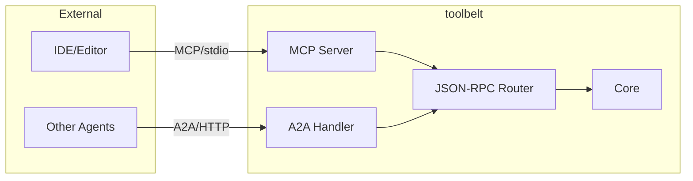

### 10.2 MCP (Model Context Protocol)

`tb` acts as an **MCP server**, exposing tools. The JSON below is illustrative (`tb_run` does not exist); the real list (48 tools with `TB_GRAPH=on` in v0.0.8) is in [cli.md](cli.md).

```json
{
  "tools": [
    {
      "name": "tb_run",
      "description": "Runs a command in the sandbox",
      "inputSchema": {
        "type": "object",
        "properties": {
          "command": {"type": "string"},
          "timeout": {"type": "string"},
          "sandbox": {"type": "boolean"}
        }
      }
    },
    {
      "name": "tb_graph_search",
      "description": "Searches the knowledge graph",
      "inputSchema": {
        "type": "object",
        "properties": {
          "query": {"type": "string"},
          "types": {"type": "array", "items": {"type": "string"}}
        }
      }
    },
    {
      "name": "tb_graph_callers",
      "description": "Finds callers of a function",
      "inputSchema": {
        "type": "object",
        "properties": {
          "function": {"type": "string"},
          "depth": {"type": "integer"}
        }
      }
    }
  ]
}
```

### 10.3 A2A (Agent-to-Agent)

For communication between agents in the hierarchy:

> **Implemented (v0.0.5):** local agent ↔ agent transport is the `tb bus` bus ([ADR-013](adr/013-barramento-multi-vendor.md)), with the `bus/0.1` JSON-RPC envelope specified in [bus-protocolo.md](bus-protocolo.md) over a SQLite store (`.toolbelt/bus/bus.db`), not a Unix socket. The example below is illustrative.

```json
{
  "jsonrpc": "2.0",
  "method": "task.assign",
  "params": {
    "from_agent": "supervisor-001",
    "to_agent": "worker-002",
    "task": {
      "id": "task-123",
      "type": "implement",
      "description": "Implement the parseConfig function",
      "context": {
        "files": ["src/config/schema.go"],
        "graph_nodes": ["node-456", "node-789"]
      },
      "budget": {
        "tokens": 5000,
        "timeout": "3m"
      }
    }
  },
  "id": 1
}
```

### 10.4 Transport

| Scenario | Transport |
|----------|-----------|
| IDE ↔ tb | stdio (MCP standard) |
| tb ↔ child process | stdio + JSON-RPC |
| agent ↔ agent (local) | Unix socket |
| agent ↔ agent (remote) | HTTP/2 + mTLS |

---

## 11. Benchmark and KPIs

See [docs/benchmark.md](benchmark.md) for full details.

### KPI Summary

| KPI | Description | Goal |
|-----|-------------|------|
| `pass@1` | First-attempt success rate | > 70% |
| `tokens_per_task` | Tokens consumed per task | < baseline |
| `wall_time` | Total execution time | < baseline |
| `tool_calls` | Number of tool calls | < baseline |
| `rework_rate` | Rework rate | < 20% |
| `guard_violations` | Blocked security violations | 0 unblocked |

---

## 12. Adversarial Verification (`tb verify`)

### 12.1 Concept: Generator vs Discriminator Loop

Inspired by GANs (Generative Adversarial Networks), toolbelt implements an **adversarial loop** where:

- **Generator** (implementer): runs the task and submits for verification
- **Discriminator** (verifier): an independent agent that tries to FAIL the work

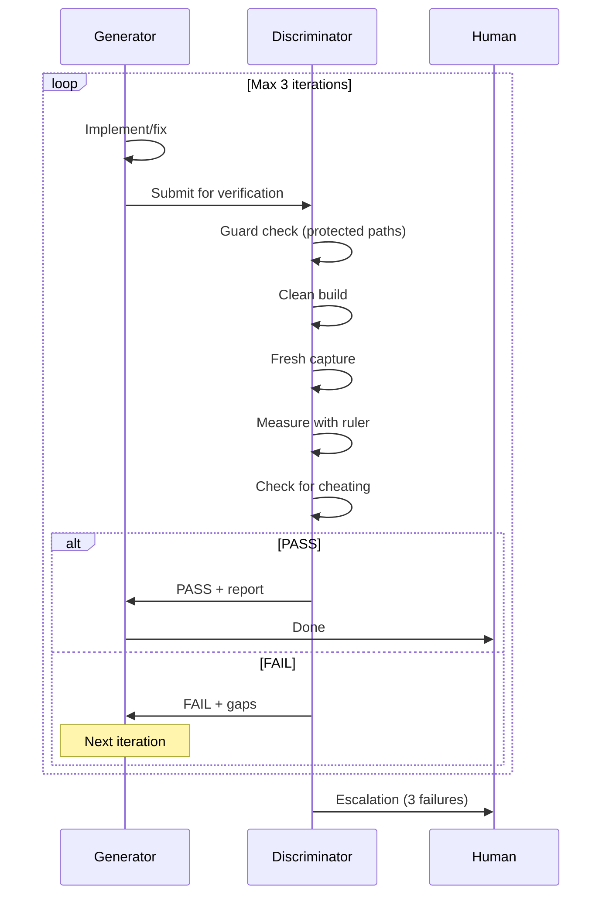

**Fundamental principle**: Only the discriminator's measurement counts as proof. Generator measurements are informative, never evidentiary.

### 12.2 Pluggable Rulers

The `tb verify` system is generic, with domain-specific **rulers**:

| Ruler | Domain | Metric | Threshold |
|-------|--------|--------|-----------|
| `visual` | UI/screens | Pixel similarity + WCAG | ≥ 95% per screen |
| `tests` | Code | Pass on hidden tests | 100% |
| `review` | Documents | Fresh-context review coverage | Configurable |

Each ruler defines:
- Primary metric and pass threshold
- Specific cheating rules
- Report format

### 12.3 Discriminator Sandbox

The discriminator operates in total isolation:

```yaml
discriminator:
  sandbox:
    port: dedicated      # own port
    database: dedicated  # own DB
    network: isolated    # no access to the generator
  
  permissions:
    push: denied
    branch_switch: denied
    stash: denied
    fix_code: denied     # reports only, never fixes
  
  cleanup: required      # clean up after the run
```

### 12.4 Guard Check and Protected Paths

Before measurement, the discriminator runs a **guard check** over `base..head`:

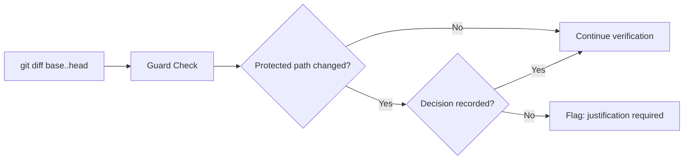

**Protected paths** (built-in defaults + optional `.toolbelt/guard.yaml`):

Defaults: `tests/hidden/*`, `benchmarks/*`, `.toolbelt/thresholds.yaml`, `.toolbelt/guard.yaml`. Entries in `protected_paths` in the YAML on the **base** (string or `pattern`) are merged with these defaults; a missing file does not remove the defaults. Case-insensitive matching with globs (`**`); malformed YAML fails closed. A pattern with a trailing slash (`secrets/`) is treated as a directory prefix (protects children).

```yaml
protected_paths:
  - pattern: "references/**"
    reason: "Visual references cannot be edited without a decision"
  
  - pattern: "masks/**"
    reason: "Masks require a dynamic-region justification"
  
  - pattern: "**/comparator.{js,ts,go}"
    reason: "Comparison logic is immutable"
  
  - pattern: ".toolbelt/thresholds.yaml"
    reason: "Thresholds cannot be relaxed"
  
  - pattern: "**/*.seed"
    reason: "Deterministic seeds are fixed"
```

Changes to protected paths are **not automatically cheating**, but require a decision recorded in the vault or explicit approval.

### 12.5 Definition of Cheating

Cheating causes an **immediate FAIL**, even if the primary metric passes:

| Type | Description | Detection |
|------|-------------|-----------|
| Reference edit | Modify/delete existing refs | Guard check |
| Invalid mask | Mask without a real dynamic region | Justification analysis |
| Comparator change | Change threshold, padding, counting | Guard check |
| Seed change | Alter seed to hide differences | Guard check |
| Wrong state | Capture a state different from the designed one | Comparison with spec |
| Inverted design | Move the design toward the code | Diff on the design |

### 12.6 Iteration and Escalation Policy

```yaml
verification:
  max_iterations: 3
  
  on_pass:
    - log_result
    - update_audit
    - notify_generator
  
  on_fail:
    iteration_1:
      - provide_gaps
      - return_to_generator
    iteration_2:
      - provide_detailed_gaps
      - suggest_fixes
      - return_to_generator
    iteration_3:
      - escalate_to_human
      - provide_full_report
      - block_merge
```

### 12.7 Discriminator Report

```yaml
report:
  verdict: PASS | FAIL
  
  per_screen:
    - screen: "login"
      light_mode: 97.2%
      dark_mode: 95.8%
      size_match: true
      contrast_pass: true
  
  gaps:
    - id: G1
      file: "src/components/Button.tsx"
      line: 45
      issue: "Button color differs 12% from the design"
      proposed_fix: "Use var(--primary-600) instead of #3b82f6"
  
  accepted_deviations:
    - reason: "System font differs across OSes"
      approved_by: "decision-2026-01-15"
  
  design_system_followups:
    - "Consider adding --primary-600 to the token set"
  
  cheating_detected: []
  
  metrics:
    build_time: "45s"
    capture_time: "12s"
    comparison_time: "3s"
```

---

## 13. Open Questions

### 13.1 Integration vs Reimplementation

- **Graphify**: integrate via MCP or reimplement indexing?
  - Integration: less work, depends on external maintenance
  - Reimplementation: full control, can optimize for the use case
  - **Decided ([ADR-014](adr/014-graphify-reimplementacao.md))**: reimplement; `tb graph explain`/`path` delivered, roadmap in the ADR

### 13.2 Inference Model for Provenance

- Which model to use to infer semantic relationships?
- Should it run locally or via API?
- Cost vs inference quality trade-off

### 13.3 Agent State Persistence

- Where to persist agent state between sessions?
- Format: JSON, SQLite, or in the vault itself?
- How to handle orphan agents?

### 13.4 Hierarchy Scalability

- How many workers per supervisor?
- How many supervisors per planner?
- How to balance load?

### 13.5 Vault Versioning

- Should the vault be versioned together with the code?
- How to merge memory changes?
- How to handle branch-specific memory?

---

## 14. Research Findings (2026-11)

In November 2026, a review of ~100 primary sources (papers, specs, official blogs, repos, and benchmarks) identified findings that may change toolbelt's design.

See the full documentation in [docs/pesquisa/](pesquisa/):
- [Primary sources](pesquisa/fontes-primarias.md) — tables by area with all sources
- [Top 10 readings](pesquisa/top-10.md) — the 10 most important sources to start with
- [Findings and new ideas](pesquisa/achados.md) — concrete proposals by module

### Pending Proposals by Module

| Module | Proposal | ADR/Status |
|--------|----------|------------|
| **mem/ctx** | Invariants file pinned outside compaction; hybrid compaction (mechanical extraction + LLM summary) | [ADR-010](adr/010-invariantes-fora-compactacao.md) (proposed; invariants in `tb mem` implemented, hybrid compaction pending) |
| **mem/ctx** | AGENTS.md as default local context; bitemporal memory with fact invalidation | partial: `tb init` reads/`--write-agents` seeds `AGENTS.md`/`CLAUDE.md` (never overwrites); `tb ctx` still pending |
| **graph** | On-demand `tb graph` with A/B by task type; prioritize human skills | [ADR-011](adr/011-grafo-sob-demanda.md) (accepted) |
| **verify** | Held-out suite the generator never sees; visible/hidden gap as KPI | pending |
| **guard** | Trajectory monitor (suspicion score); cheating patterns beyond deleting tests | pending |
| **benchmark** | `tb bench --impossible` to detect cheating; pass^k beyond pass@1; cost×accuracy frontier | pending |
| **protocol** | Stateless `tb mcp` (MCP 2026-07-28); tools as files + deferred search | pending |
| **router** | Mandate with base commit and files; disjoint scopes for parallelism; waste watchdog | partially in [ADR-009](adr/009-router-e-workers.md) |

**Note**: proposals marked "pending" are documented in [achados.md](pesquisa/achados.md) but do not yet have an ADR.

---

## 15. Inspirations

Toolbelt incorporates patterns from three reference projects:

| Project | What We Adopted |
|---------|-----------------|
| **[Graphify](https://github.com/Graphify-Labs/graphify)** | Queryable graph, AST indexing, provenance (extracted vs inferred), graph-first hooks |
| **[Obsidian](https://obsidian.md/)** | Markdown vault as source of truth, wikilinks, backlinks, YAML frontmatter, local-first |
| **[Elephant-Goldfish Model](https://github.com/google/elephant-goldfish-model)** | Fresh-context review, author/reviewer separation, draft→review→resolve workflow, drift detection |

See the ADRs for details:
- [ADR-006: Graphify and Obsidian](adr/006-inspiracoes-graphify-obsidian.md)
- [ADR-007: Elephant-Goldfish Model](adr/007-inspiracao-elephant-goldfish.md)

---

## References

- [MCP Specification](https://spec.modelcontextprotocol.io/)
- [Google A2A Protocol](https://github.com/google/A2A)
- [Graphify](https://github.com/Graphify-Labs/graphify)
- [Obsidian](https://obsidian.md/)
- [Elephant-Goldfish Model](https://github.com/google/elephant-goldfish-model)
- [bubblewrap](https://github.com/containers/bubblewrap)
- [Landlock](https://landlock.io/)
- [tree-sitter](https://tree-sitter.github.io/)
- [Bubble Tea](https://github.com/charmbracelet/bubbletea)
