🇺🇸 English | [🇧🇷 Português](pt-BR/arquitetura.md)

# toolbelt Architecture (`tb`)

## Overview

`toolbelt` is a set of tools for AI coding agents, unified under a single binary (`tb`) and protocol. The goal is to provide a safe, efficient, and verifiable environment for autonomous agents to run development tasks.

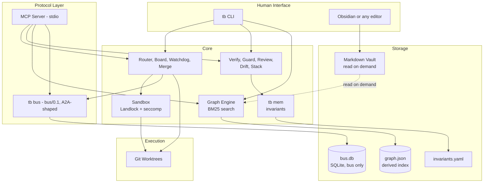

---

## 1. Workspace and Sandbox

### 1.1 Isolation by Worktree

Each agent operates in a dedicated **git worktree**, enabling:

- Parallel work without branch conflicts
- Instant snapshot and rollback via git
- Simple cleanup when the task finishes

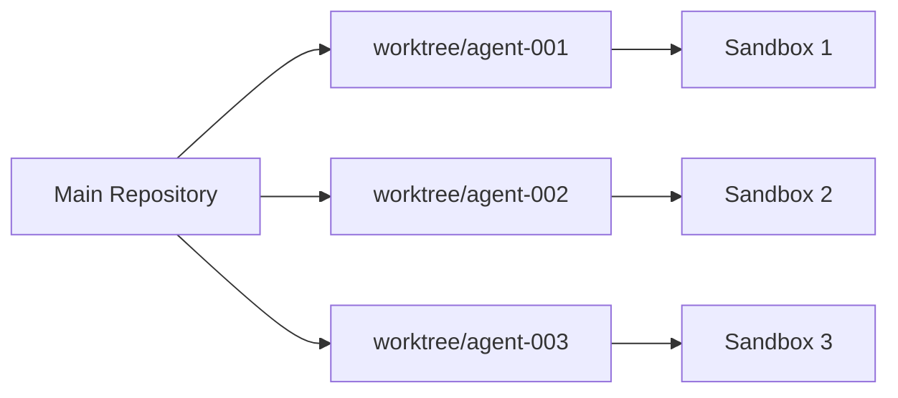

### 1.2 Isolation Layers

| Layer | Technology | Responsibility |
|-------|------------|----------------|
| Filesystem | Landlock | Restricts reads and writes of the child (and its descendants) to the worktree, a private `TMPDIR`/`HOME` and the allowed paths. **Fail-closed**: without Landlock, `tb sandbox run`, `tb router run` and `tb_run` refuse to run unless `--allow-unsandboxed` / `sandbox.allow_unsandboxed` is set |
| Network | seccomp | A filter, installed by the Landlock trampoline (Linux amd64/arm64), that makes `socket(2)`, `socketpair(2)` and `io_uring` fail with `EPERM`. It is an option of the sandbox (`DenyNetwork`), used for the embedding child of `tb graph index --vectors`; `tb sandbox run`, router workers and `tb_run` do not restrict the network |
| Environment | allowlist | The child gets only allowlisted variables; secret-looking names (`*TOKEN*`, `SECRET`, `KEY`, `PASSWORD`) are blocked unless `--pass-env` names them |
| Processes | process group, subreaper, `PDEATHSIG` | A timeout or cancel kills the whole group; the router sweeps descendants that escaped it |

**Not built, and not planned for 1.0:** bubblewrap (mount namespaces), cgroups v2 (CPU/RAM limits), network namespaces and a per-host network whitelist. `tb` limits time (`--timeout`), not CPU or memory.

### 1.3 Snapshot and Rollback

`tb` has no automatic snapshot, stash or `git reset --hard` around a task. The mechanisms that exist:

1. **Worktrees**: each router worker, and `tb workspace create`, gets its own git worktree under `.toolbelt/workspaces/`; discarding the work is removing the worktree.
2. **Ticket results**: a ticket records `base_commit`, `head_commit` and the branch; `tb drift` and `tb review` compare the diff to them.
3. **`tb merge`**: applies `done` tickets atomically (`fail`, `last_wins`, `semantic`, `prompt`) and leaves a receipt; a refused merge moves no ref.

---

## 2. Memory vs Context

**Memory** and **context** are distinct concepts:

| Aspect | Memory | Context |
|--------|--------|---------|
| **Definition** | Persistent storage of facts, decisions, summaries, and the graph | What is assembled into the model window for a specific task |
| **Persistence** | Permanent (Markdown vault, `graph.json`, `invariants.yaml`) | Ephemeral (lasts one request) |
| **Size** | Unlimited (grows with the project) | Limited by the token budget |
| **Format** | Markdown + frontmatter + graph | Text serialized for the prompt |

> **Status:** the memory side exists as `tb mem` (invariants in `.toolbelt/invariants.yaml`), the vault ([§3.1](#31-markdown-vault-source-of-truth)) and the graph. There is no context assembler and no token budget in `tb` (§2.1 and §2.2 describe the design vision): an agent builds its own context by querying `tb_mem_list` and `tb_graph_*`, and the router hands a worker one ticket file.

### 2.1 Context Types

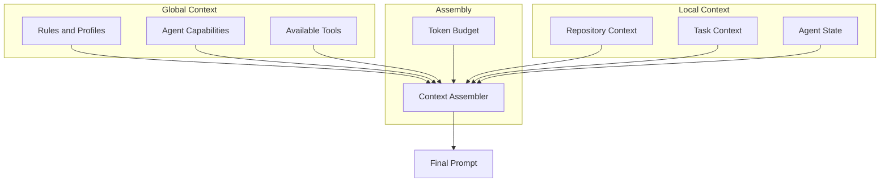

### 2.2 Context Hierarchy

1. **Global**: system rules, user profile, available MCP tools
2. **Repository**: project structure, conventions, main dependencies
3. **Agent**: role/persona, recent history, specific capabilities
4. **Task**: objective, relevant files, graph query results

The **Context Assembler** receives a token budget and prioritizes the most relevant information, truncating or summarizing when needed.

---

## 3. Storage: Markdown Vault and the Derived Graph Index

### 3.1 Markdown Vault (Source of Truth)

Inspired by Obsidian, long-term notes are Markdown files that humans edit in any editor ([spec](specs/vault.md), [ADR-016](adr/016-vault-fase-a.md)). `tb vault` reads them from disk on every command: there is no watcher, no sync and no persistent index for notes. This is the state `tb` keeps in a repository:

```
.toolbelt/
├── config.yaml          # local configuration (tb init)
├── agent_docs.yaml      # AGENTS.md/CLAUDE.md hints recorded by tb init
├── invariants.yaml      # tb mem: invariants outside compaction
├── guard.yaml           # optional: extra protected paths (read from the base ref)
├── thresholds.yaml      # optional: coverage floor (read from the base ref)
├── screens.yaml         # optional: visual ruler manifest
├── secchecks.yaml       # tb blue apply: registered security checks
├── vault/               # Markdown notes with frontmatter and [[wikilinks]]
├── graph.json           # derived graph index (tb graph index)
├── graph.vec            # optional vector index (tb graph index --vectors)
├── tickets/             # TKT-*.yaml (tb ticket)
├── board.yaml           # board control: pause, resume, drain
├── router/              # state.json, alerts.jsonl, logs/ (tb router)
├── workspaces/          # git worktrees of running tickets
├── bus/bus.db           # SQLite store of the local bus
└── egm/receipts/        # committed EGM receipts
```

Private state (bus sessions, EGM state, merge receipts, lab state) lives outside the repository under `$XDG_STATE_HOME`; see the specs.

Each note uses:
- **YAML frontmatter**: `type` (`fact`, `decision`, `context`, `log`), `tags`, `source` (`manual`, `extracted`, `inferred`), `confidence`
- **Wikilinks**: `[[other-note]]`, resolved by `tb vault`; broken and ambiguous links fail `tb vault check`
- **Backlinks**: computed on demand (`tb vault backlinks`)

### 3.2 Graph Index: `graph.json` and BM25

The graph is a **derived** index of the code and docs, rebuilt on demand, not a database. `tb graph index` writes `.toolbelt/graph.json`:

```json
{
  "root": "/path/to/repo",
  "nodes": [{"id": "...", "type": "function", "path": "...", "title": "...", "package": "...", "source": "extracted", "confidence": 0.9}],
  "edges": [{"source_id": "...", "target_id": "...", "type": "calls", "source": "extracted", "confidence": 0.9}],
  "fingerprint": "...",
  "built_at": "..."
}
```

- Node types: `file`, `function`, `package`, `class`, `section`, `component`, `hook`, `route`, `playbook` (and vault `note`/`tag` nodes). Edge types: `imports`, `calls`, `defines`, `links`, `tagged`, `mentions`, `renders`, `template`, `mirror`.
- **Search** is BM25 over title, path and package, with camelCase and `snake_case` splitting and multi-term queries. There is no SQL and no FTS5 index.
- **Staleness**: the index carries a fingerprint of the tree. The CLI reindexes when it is stale; over MCP the queries never reindex and report `stale: true`, so the agent calls `tb_graph_index` and repeats. `tb graph rebuild` rebuilds everything from scratch.
- **Optional vectors**: `tb graph index --vectors` also writes `graph.vec` (embeddings from a vendored llama.cpp child, [ADR-018](adr/018-cgo-componentes-nativos.md)), used by `tb graph search --mode semantic|hybrid`.

SQLite exists in `tb` only as the store of the local bus (`.toolbelt/bus/bus.db`). The SQLite + FTS5 index with `nodes`/`edges` tables that [ADR-003](adr/003-sqlite-fts5-grafo.md) proposed was never built: it was superseded by `graph.json` ([ADR-011](adr/011-grafo-sob-demanda.md), [ADR-014](adr/014-graphify-reimplementacao.md)).

### 3.3 Vault and Graph

The vault feeds the graph in one direction, when the graph is indexed: with `vault.graph` on (default), notes become `note:<path>` nodes, headings become `section` nodes, resolved wikilinks become `links` edges and tags become `tag:<tag>` nodes. The vault is read without following symlinks. Nothing writes back to the vault and nothing watches it; if `graph.json` is stale, `tb graph index` reads the vault again.

### 3.4 Code Indexing with Provenance

Inspired by Graphify and reimplemented in toolbelt ([ADR-014](adr/014-graphify-reimplementacao.md)), `tb graph` indexes code with `go/ast` (Go) and conservative regex extractors (TS/JS, Python, Rust, frameworks). tree-sitter remains a future option, not implemented:

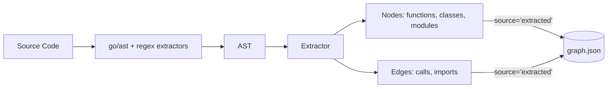

**Edge provenance**: every edge the indexer emits today has `source: extracted` and a `confidence` below 1.0 where the extractor is heuristic (regex extractors, soft-resolved calls). The `inferred` value is reserved for relations a language model would propose; no inference step exists. A vault note carries the `source` and `confidence` of its own frontmatter (`manual`, `extracted` or `inferred`).

### 3.5 Queries for Agents

The graph exposes queries that save tokens:

```bash
# Who calls this function?
tb graph callers --function "parseConfig" --depth 2

# What are this module's dependencies?
tb graph deps --module "auth" --transitive

# What is the impact of changing this file?
tb graph impact --file "src/config/parser.go"

# Semantic search
tb graph search "JWT authentication"
```

**Hooks for agents**: before reading raw files, the agent should query the graph:

```
1. Receives task: "Fix bug in the config parser"
2. tb graph search "parser config" → finds relevant nodes
3. tb graph callers --function "parseConfig" → learns who uses it
4. tb graph impact --file "parser.go" → assesses scope
5. Only then reads the specific files needed
```

This drastically reduces the number of tokens consumed reading files.

---

## 4. Security

### 4.1 Threat Model

| Threat | Mitigation |
|--------|------------|
| Sandbox escape | Landlock filesystem rules (fail-closed) and the seccomp network filter for the embedding child; process-group kill on timeout |
| Secret access | Child environment allowlist; secret-looking variables blocked unless `--pass-env`; redaction of secrets in vault and MCP output, EGM prompts and graph embedding input |
| Test modification | `tb guard` protected paths (`tests/hidden/*`, `.toolbelt/thresholds.yaml`, `.toolbelt/guard.yaml`, ...) read from the **base** ref, plus the hidden suite of `tb verify` |
| Data exfiltration | `tb` itself is local-only and never calls GitHub or any remote service; a sandboxed child can reach the network unless the sandbox option `DenyNetwork` is set (only the embedding child sets it) |
| Privilege escalation | `tb` runs as the user, never asks for root and never widens a sandbox on its own; `--allow-unsandboxed` is an explicit opt-in |
| Reward hacking | Implementer ≠ reviewer (fresh-context `tb review`), `tb guard` anti-cheat scan, `tb drift` |

### 4.2 Permissions

There are no capability roles. What exists:

- **Per run**: the Landlock rules of §1.2 (worktree read-write, system paths read-only).
- **Per ticket**: the mandate (`scope`, `forbidden`, `permissions`) is checked after the fact by `tb guard`, `tb review` and `tb drift`; for router and bus tasks the worker runs confined to its worktree.
- **On the bus**: the role (`router`, `supervisor`, `worker`, `reviewer`) is fixed by the invite the human created, and the broker enforces what each role may do ([bus-protocolo.md](bus-protocolo.md)).

### 4.3 Capability Tokens: dropped

Capability tokens (`CapabilityToken`), approval queues and role files under `.tb/roles/` were part of the original design. [ADR-020](adr/020-agent-hierarchy-a2a.md) dropped `tb agent` and with it this model: a destructive action is the human's decision, taken by running a command, not a token an agent requests.

### 4.4 Secret Handling

`tb` does not hold or inject secrets. The child environment is built from an allowlist (`--env NAME` adds a variable; `--pass-env NAME` is the explicit opt-in for one that looks like a secret). `tb mem add` stores an invariant as typed; `tb mem` output is redacted (`internal/mem/redact.go`). Text that leaves the process (EGM prompts, vector embedding input) is redacted with the patterns of `internal/secrets`, and note text printed by `tb vault --json` and `tb_vault_*` with `mem.SecretPatterns()` plus the vault's own patterns (`internal/vault/redact.go`).

---

## 5. Scripts and Processes

### 5.1 `tb run` and `tb proc`: planned, not implemented

`tb run` and `tb proc` are not in the CLI, and `tb run --sandbox --allow-net` does not exist. What runs a command today:

```bash
# Run a command under Landlock, with a timeout
tb sandbox run --timeout 30s -- go test ./...
```

MCP `tb_run` does the same for agents (see [cli.md](cli.md#mcp-tb_run-sandbox)). Supervising long-running processes (`tb proc start|list|logs|stop`) stays on the roadmap in the README.

### 5.2 Process Management

The router and `tb bus run` start each worker in its own process group. A timeout or `tb watchdog kill` ends the whole group (SIGKILL), and the router reports descendants that escaped it as orphans. There is no per-process CPU or memory limit (no cgroups).

---

## 6. Roles and Personas: dropped

`.tb/roles/*.yaml`, per-role capabilities and tool lists, and `tb:agent:spawn` were dropped with `tb agent` ([ADR-020](adr/020-agent-hierarchy-a2a.md)). A worker's persona is whatever the human configures in the agent itself. `tb` knows two things about an agent: its bus role, fixed by the invite (`router`, `supervisor`, `worker`, `reviewer`), and its Agent Card, the capabilities it declares when it joins ([bus-protocolo.md](bus-protocolo.md)).

---

## 7. TUI Markdown (`tb md`) — dropped

There is no TUI. `tb md` and `tb md --obsidian` were dropped from the vault's Phase A ([ADR-016](adr/016-vault-fase-a.md)) and are not planned ([ADR-020](adr/020-agent-hierarchy-a2a.md)). Any editor, Obsidian included, edits the vault (`.toolbelt/vault/`, read from disk by `tb vault`, with no watcher or sync); see [specs/vault.md](specs/vault.md). The visual theme applies to terminal output and the site ([identidade-visual.md](identidade-visual.md)).

---

## 8. Agent Network

### 8.1 Hierarchy

> **What exists ([ADR-020](adr/020-agent-hierarchy-a2a.md)):** the diagram below is the original vision, not the implementation. Delegation today is `tb router run` (§8.6) handing tickets to local workers or to agents on a `tb bus` channel, and bus roles fixed by the human's invites (`router`, `supervisor`, `worker`, `reviewer`). There is no planner process and no `tb agent spawn`. A second level (a supervisor delegating sub-threads with a broker-checked `parent`, bounded depth and fan-out, `tb bus tree`) is specified in [specs/agent-hierarchy.md](specs/agent-hierarchy.md).

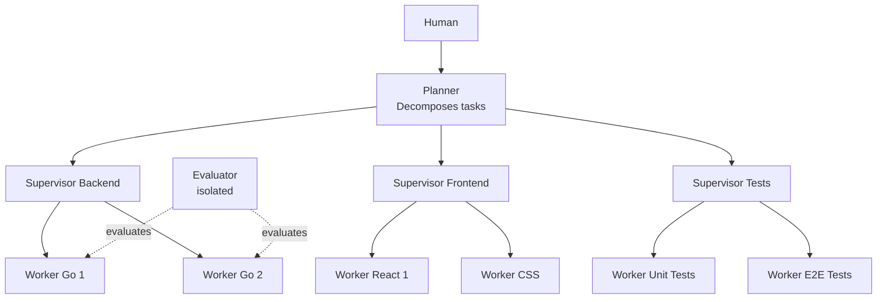

### 8.2 Context Flow

The context a router worker receives is its ticket: the mandate (scope, forbidden paths), the acceptance criteria and the timeout, as a file named by `TB_TICKET_FILE`, in its own worktree. There is no planner that passes context down a hierarchy; the sequence the original design drew (human, planner, supervisor, worker) is the vision, not the implementation.

### 8.3 Agent Lifecycle

`tb` does not manage an agent's lifecycle (no spawn, idle timeout or approval state). It tracks two things:

- the **ticket**: `pending` → `running` → `done` | `failed` (or `canceled`; `tb ticket retry` goes back to `pending`);
- the **bus claim** of a thread: a lease with heartbeat and epoch fencing, `held` → `released` | `expired` ([bus-lease.md](bus-lease.md)).

### 8.4 Budgets

> **Not implemented, and token budgets are not planned ([ADR-020](adr/020-agent-hierarchy-a2a.md)):** `tb` cannot meter a vendor agent's tokens. What exists are the router's timeouts and `retry.max_attempts`, the harness wake budget (`budget.max_wakes`) and, in the delegation-tree spec, depth and fan-out limits.

Each agent has limits:

```yaml
budgets:
  planner:
    tokens_per_task: 50000
    max_subtasks: 10
    timeout: 30m

  supervisor:
    tokens_per_task: 20000
    max_workers: 5
    timeout: 15m

  worker:
    tokens_per_task: 8000
    max_tool_calls: 50
    timeout: 5m
```

### 8.5 Elephant-Goldfish Pattern

Inspired by Google's [Elephant-Goldfish Model (EGM)](https://github.com/google/elephant-goldfish-model), toolbelt implements a review workflow with context isolation:

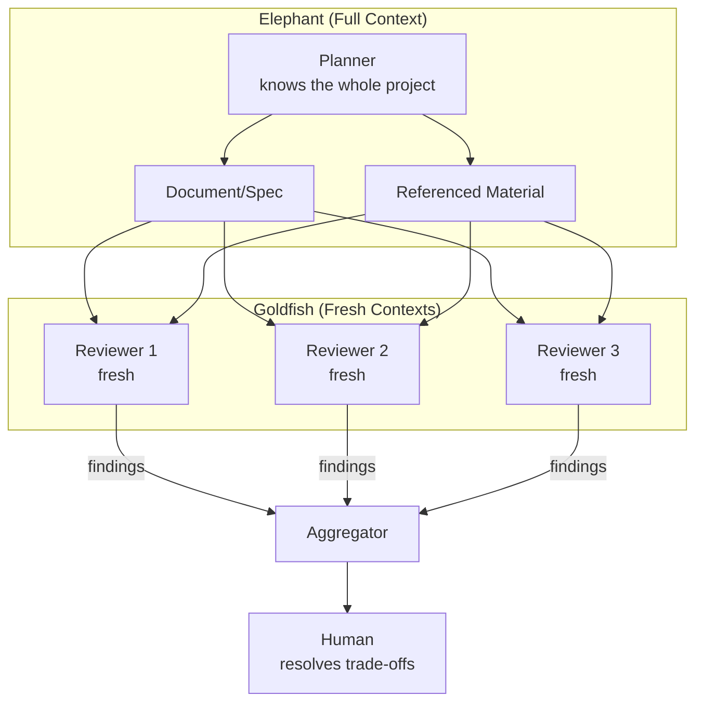

**Roles**:

| Role | Context | Responsibility |
|------|---------|----------------|
| Elephant (Planner) | Full | Drafts specs, brainstorms, knows the whole project |
| Goldfish (Reviewers) | Fresh | Reviews without prior context, finds gaps and assumptions |
| Human | N/A | Resolves trade-offs, approves changes |

**Why fresh context?**

1. **Quality guard**: a reviewer without context finds problems the author, blinded by accumulated knowledge, does not see
2. **Token savings**: reviewers receive only the document + sources, not the whole project
3. **Anti-cheating**: reinforces author ≠ reviewer separation

**Implementation via `tb review`**:

```bash
# Review a diff against a local ticket with 3 distinct goldfish
tb review --ticket rd.md --reviewers 3 --standards scope,quality,acceptance

# Review a design document until the review converges
tb egm review docs/design-auth.md
```

Context isolation is **mandatory**: if the system cannot create fresh contexts, the review fails instead of proceeding with contaminated context.

### 8.6 Router/Workers Pattern

For complex tasks that require high parallelization and context savings, toolbelt supports the Router/Workers pattern:

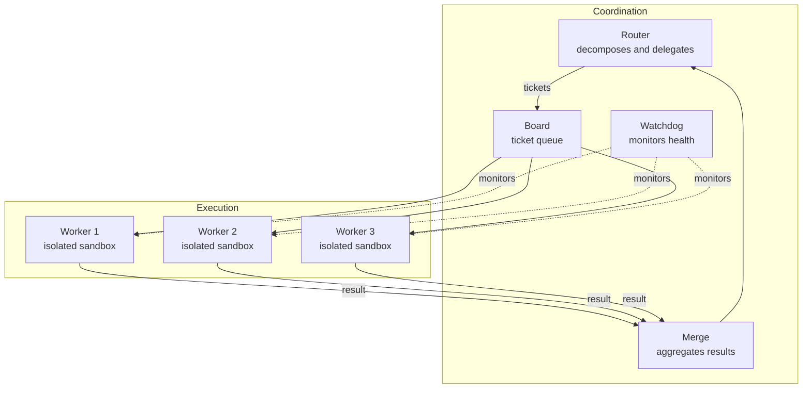

**Main concepts**:

| Concept | Description |
|---------|-------------|
| **Ticket** | Atomic unit of work with scope, permissions, and acceptance criteria |
| **Mandate** | Defines which files the worker may read/write and which are forbidden |
| **Board** | Coordination queue with support for prioritization and dependencies |
| **Watchdog** | Monitor that detects slow/stuck workers and emits alerts (`worker_slow`, `worker_stuck`, `queue_growing`…); runs inside the router loop and does not scale workers automatically |
| **Merge** | Aggregator that resolves conflicts between workers and applies changes atomically |

**Execution flow**:

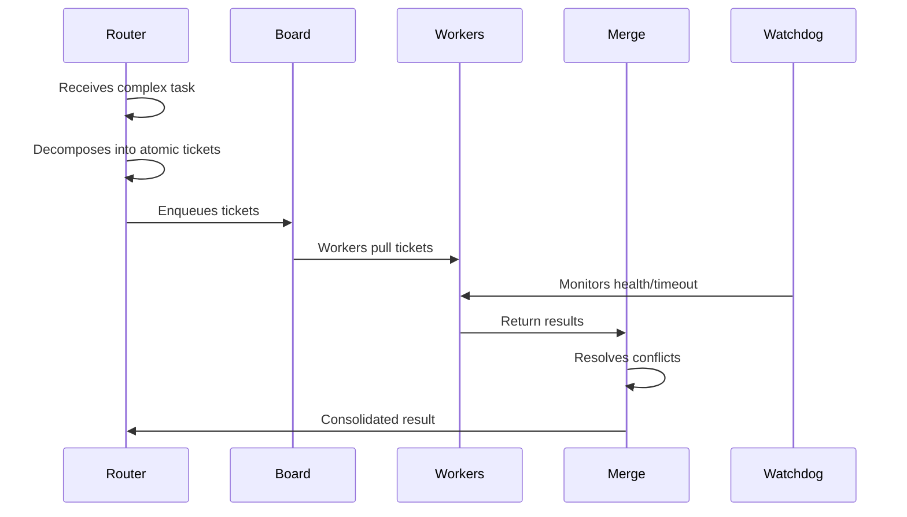

**Ticket example**:

```yaml
ticket:
  id: "TKT-001"
  title: "Implement login handler"
  mandate:
    scope: ["src/handlers/auth.go", "src/services/auth.go"]
    permissions: [read, write]
    forbidden: ["src/database/*", "tests/hidden/*"]
  acceptance:
    criteria: ["Tests in tests/auth_test.go pass"]
    timeout: "10m"
  dependencies: []
```

**Benefits**:

- **Minimal context**: a worker receives its ticket, not the whole conversation (the saving is not measured; see [ADR-009](adr/009-router-e-workers.md))
- **Parallelization**: independent tickets run simultaneously
- **Failure isolation**: an error in one worker does not pollute others' context
- **Cache-read**: workers reuse token cache via repeated contexts
- **Audit**: each ticket has an isolated, traceable history

**Direct Delivery**:

When a worker completes a ticket with dependents, it can subscribe to receive dependent tickets **directly**, without going through the Board:


Benefits of direct delivery:
- **Lower latency**: ticket does not wait in the queue
- **Context affinity**: worker already has relevant context
- **Maximized cache-read**: previous ticket tokens in cache
- **Fewer conflicts**: the same worker edits related files

**Implementation via `tb router` and `tb ticket`**:

```bash
# Create tickets (--title or --from rd.md; dependencies via --dep)
tb ticket create --title "Create User model" --scope "src/models/**"
tb ticket create --title "JWT signing" --dep TKT-001

# Run the router (foreground; Ctrl-C returns running -> pending)
tb router run --agent-cmd "my-agent --task-file $TB_TICKET_FILE"

# View the ticket board
tb board list --status pending,running

# Monitor workers (active subscriptions, alert counts)
tb watchdog status

# Merge results (strategies: fail | last_wins | semantic | prompt)
tb merge TKT-001 TKT-002
```

The router is a **foreground** scheduler (`tb router run`; there is no
`start`/`stop` daemon); the watchdog runs inside the same loop and persists
state and alerts under `.toolbelt/router/`. Details in [cli.md](cli.md).

See [ADR-009](adr/009-router-e-workers.md) for design details.


---

## 9. Anti-Cheating Protections

### 9.1 Principles

1. **Implementer/evaluator separation**: whoever implements never evaluates their own code
2. **Test immutability**: protected paths are checked against the base ref, never against the diff under review
3. **Traceable results**: tickets, merge receipts, EGM receipts and the bus message log record who did what (there is no single audit log, see §9.3)
4. **Anomaly detection**: `tb guard` flags suspicious patterns in the diff, and `tb watchdog` flags slow or stuck workers

### 9.2 Test File Protection

```bash
# Compare a range against the protected paths and the anti-cheat scan
tb guard check main..HEAD

# The verify loop runs the same check first, then the tests ruler
# (hidden suite from tests/hidden/ when present)
tb verify run --base main --head HEAD
```

`tb guard check` reads `protected_paths` from `.toolbelt/guard.yaml` on the **base** ref and merges them with the defaults (see §12.4). There are no `tb guard snapshot` or `tb guard verify` subcommands, and no read-only mounts of test files: protection is a check on the diff, not a filesystem barrier.

### 9.3 Audit Log: not implemented

There is no `audit.log`, no per-action record, no capability token and no hash chain. What exists, each with its own scope:

| Record | Where | Content |
|--------|-------|---------|
| Bus message log | `.toolbelt/bus/bus.db` (`tb bus log`) | every message of a channel, with its envelope |
| Ticket result | `.toolbelt/tickets/TKT-*.yaml` | status, worker, base/head commit, exit code, attempts |
| Router state and logs | `.toolbelt/router/` | `state.json`, `alerts.jsonl`, per-worker logs |
| Merge receipt | private state dir | what a `prompt` merge was asked and what it applied |
| EGM receipt | `.toolbelt/egm/receipts/` | committed claims of the author, certified by the review loop |
| Verify report | `tb verify run --json` | per-gate and per-ruler outcome |

### 9.4 Reward Hacking Detection

What `tb guard check` detects today:

| Pattern | Indicator | Action |
|---------|-----------|--------|
| Deleted tests | A test file is removed | `SeverityError`, exit ≠ 0 |
| Protected path edited | Diff touches a protected path | `SeverityError`, exit ≠ 0 |
| Test skips | `t.Skip()`, `it.skip`, `describe.skip`, `test.skip`, `xit`, `.only` | warning |
| Trivial assertions | e.g. `expect(true).toBe(true)` | `SeverityError` |

Not implemented: detecting hardcoded outputs, mutation analysis for artificial coverage, and a retry-abuse score. `tb verify run` caps its loop at 3 iterations and ends in `ESCALATE`.

---

## 10. Protocols

### 10.1 Overview

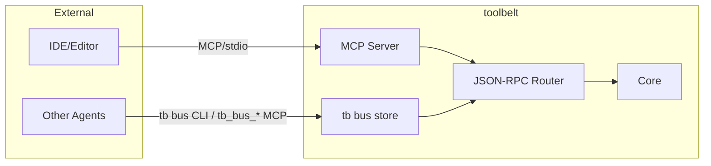

### 10.2 MCP (Model Context Protocol)

`tb` acts as an **MCP server**, exposing tools. The JSON below is abbreviated and illustrative (`tb_run` exists, a sandboxed `sh -c`, but with other parameters); the real schemas come from `tools/list` and the list (54 tools with `TB_GRAPH=on`) is in [cli.md](cli.md).

```json
{
  "tools": [
    {
      "name": "tb_run",
      "description": "Runs a command in the sandbox",
      "inputSchema": {
        "type": "object",
        "properties": {
          "command": {"type": "string"},
          "timeout": {"type": "string"},
          "sandbox": {"type": "boolean"}
        }
      }
    },
    {
      "name": "tb_graph_search",
      "description": "Searches the knowledge graph",
      "inputSchema": {
        "type": "object",
        "properties": {
          "query": {"type": "string"},
          "types": {"type": "array", "items": {"type": "string"}}
        }
      }
    },
    {
      "name": "tb_graph_callers",
      "description": "Finds callers of a function",
      "inputSchema": {
        "type": "object",
        "properties": {
          "function": {"type": "string"},
          "depth": {"type": "integer"}
        }
      }
    }
  ]
}
```

### 10.3 A2A (Agent-to-Agent)

For communication between agents in the hierarchy:

> **Decision ([ADR-020](adr/020-agent-hierarchy-a2a.md)):** A2A is not a transport in `tb`. The local `bus/0.1` envelope is A2A-shaped, and `tb` has no A2A server, client, socket or HTTP. A remote A2A agent can take part only through a bridge the human writes and runs outside `tb`, admitted as an ordinary bus agent with its own invite and role.

> **Implemented:** local agent ↔ agent transport is the `tb bus` bus ([ADR-013](adr/013-barramento-multi-vendor.md)), with the `bus/0.1` JSON-RPC envelope specified in [bus-protocolo.md](bus-protocolo.md) over a SQLite store (`.toolbelt/bus/bus.db`), not a Unix socket. The example below is illustrative.

```json
{
  "jsonrpc": "2.0",
  "method": "task.assign",
  "params": {
    "from_agent": "supervisor-001",
    "to_agent": "worker-002",
    "task": {
      "id": "task-123",
      "type": "implement",
      "description": "Implement the parseConfig function",
      "context": {
        "files": ["src/config/schema.go"],
        "graph_nodes": ["node-456", "node-789"]
      },
      "budget": {
        "tokens": 5000,
        "timeout": "3m"
      }
    }
  },
  "id": 1
}
```

### 10.4 Transport

| Scenario | Transport |
|----------|-----------|
| IDE ↔ tb | stdio (MCP standard) |
| tb ↔ child process | stdio + JSON-RPC |
| agent ↔ agent (local) | `tb bus`: SQLite store (`.toolbelt/bus/bus.db`), CLI or `tb_bus_*` MCP tools; no socket |
| agent ↔ agent (remote) | none in `tb`; a bridge the human runs is an ordinary bus agent ([ADR-020](adr/020-agent-hierarchy-a2a.md)) |

---

## 11. Benchmark and KPIs

See [docs/benchmark.md](benchmark.md) for full details.

### KPI Summary

| KPI | Description | Goal | `tb bench` |
|-----|-------------|------|------------|
| `pass@1` | First-attempt success rate | > 70% | measured |
| `tokens_per_task` | Tokens consumed per task | < baseline | measured when the agent reports tokens |
| `wall_time` | Total execution time | < baseline | measured (per task) |
| `tool_calls` | Number of tool calls | < baseline | measured when the agent reports them |
| `rework_rate` | Rework rate | < 20% | not implemented |
| `guard_violations` | Blocked security violations | 0 unblocked | not implemented as a KPI (`tb guard` itself works) |

---

## 12. Adversarial Verification (`tb verify`)

### 12.1 Concept: Generator vs Discriminator Loop

Inspired by GANs (Generative Adversarial Networks), toolbelt implements an **adversarial loop** where:

- **Generator** (implementer): runs the task and submits for verification
- **Discriminator** (verifier): an independent agent that tries to FAIL the work

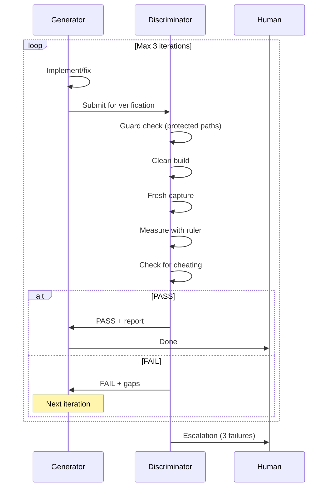

**Fundamental principle**: Only the discriminator's measurement counts as proof. Generator measurements are informative, never evidentiary.

### 12.2 Pluggable Rulers

The `tb verify` system is generic, with domain-specific **rulers**:

| Ruler | Domain | Metric | Threshold |
|-------|--------|--------|-----------|
| `visual` | UI/screens | Pixel similarity + WCAG | ≥ 95% per screen |
| `tests` | Code | Pass on hidden tests | 100% |
| `review` | Documents | Fresh-context review coverage | Configurable |

Each ruler defines:
- Primary metric and pass threshold
- Specific cheating rules
- Report format

### 12.3 Discriminator Sandbox

> **Design sketch, not configuration:** `tb verify` reads no `discriminator` block. It runs the gate commands and the rulers in the head worktree (`--base`/`--head`), with the child environment allowlist of §1.2.

The design calls for the discriminator to operate in total isolation:

```yaml
discriminator:
  sandbox:
    port: dedicated      # own port
    database: dedicated  # own DB
    network: isolated    # no access to the generator
  
  permissions:
    push: denied
    branch_switch: denied
    stash: denied
    fix_code: denied     # reports only, never fixes
  
  cleanup: required      # clean up after the run
```

### 12.4 Guard Check and Protected Paths

Before measurement, the discriminator runs a **guard check** over `base..head`:

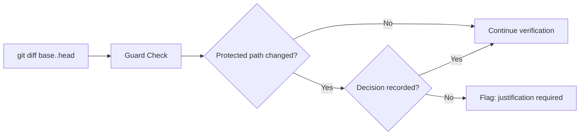

**Protected paths** (built-in defaults + optional `.toolbelt/guard.yaml`):

Defaults: `tests/hidden/*`, `benchmarks/*`, `.toolbelt/thresholds.yaml`, `.toolbelt/guard.yaml`. Entries in `protected_paths` in the YAML on the **base** (string or `pattern`) are merged with these defaults; a missing file does not remove the defaults. Case-insensitive matching with globs (`**`); malformed YAML fails closed. A pattern with a trailing slash (`secrets/`) is treated as a directory prefix (protects children).

```yaml
protected_paths:
  - pattern: "references/**"
    reason: "Visual references cannot be edited without a decision"
  
  - pattern: "masks/**"
    reason: "Masks require a dynamic-region justification"
  
  - pattern: "**/comparator.{js,ts,go}"
    reason: "Comparison logic is immutable"
  
  - pattern: ".toolbelt/thresholds.yaml"
    reason: "Thresholds cannot be relaxed"
  
  - pattern: "**/*.seed"
    reason: "Deterministic seeds are fixed"
```

Changes to protected paths are **not automatically cheating**, but require a decision recorded in the vault or explicit approval.

### 12.5 Definition of Cheating

Cheating causes an **immediate FAIL**, even if the primary metric passes:

| Type | Description | Detection |
|------|-------------|-----------|
| Reference edit | Modify/delete existing refs | Guard check |
| Invalid mask | Mask without a real dynamic region | Justification analysis |
| Comparator change | Change threshold, padding, counting | Guard check |
| Seed change | Alter seed to hide differences | Guard check |
| Wrong state | Capture a state different from the designed one | Comparison with spec |
| Inverted design | Move the design toward the code | Diff on the design |

### 12.6 Iteration and Escalation Policy

> **Partly implemented:** `tb verify run` iterates up to 3 times (`MaxIterations`) and can end in `ESCALATE`; the YAML keys below (`on_pass`, `notify_generator`, `block_merge`) are a sketch, not configuration.

```yaml
verification:
  max_iterations: 3
  
  on_pass:
    - log_result
    - update_audit
    - notify_generator
  
  on_fail:
    iteration_1:
      - provide_gaps
      - return_to_generator
    iteration_2:
      - provide_detailed_gaps
      - suggest_fixes
      - return_to_generator
    iteration_3:
      - escalate_to_human
      - provide_full_report
      - block_merge
```

### 12.7 Discriminator Report

> **Sketch:** the real report is the JSON of `tb verify run --json` (see [cli.md](cli.md)); the fields below (`per_screen`, `accepted_deviations`, `design_system_followups`) do not exist.

```yaml
report:
  verdict: PASS | FAIL
  
  per_screen:
    - screen: "login"
      light_mode: 97.2%
      dark_mode: 95.8%
      size_match: true
      contrast_pass: true
  
  gaps:
    - id: G1
      file: "src/components/Button.tsx"
      line: 45
      issue: "Button color differs 12% from the design"
      proposed_fix: "Use var(--primary-600) instead of #3b82f6"
  
  accepted_deviations:
    - reason: "System font differs across OSes"
      approved_by: "decision-2026-01-15"
  
  design_system_followups:
    - "Consider adding --primary-600 to the token set"
  
  cheating_detected: []
  
  metrics:
    build_time: "45s"
    capture_time: "12s"
    comparison_time: "3s"
```

---

## 13. Open Questions

### 13.1 Integration vs Reimplementation

- **Graphify**: integrate via MCP or reimplement indexing?
  - Integration: less work, depends on external maintenance
  - Reimplementation: full control, can optimize for the use case
  - **Decided ([ADR-014](adr/014-graphify-reimplementacao.md))**: reimplement; `tb graph explain`/`path` delivered, roadmap in the ADR

### 13.2 Inference Model for Provenance

- Which model to use to infer semantic relationships?
- Should it run locally or via API?
- Cost vs inference quality trade-off

### 13.3 Agent State Persistence

- **Answered.** `tb` persists no agent state. The bus keeps what is shared (messages, invites, sessions, claims) in `.toolbelt/bus/bus.db`; an agent's own memory is its vendor's business. Orphans are handled by the claim lease (expiry, epoch fencing) and the router's orphan sweep, not by a state store ([ADR-013](adr/013-barramento-multi-vendor.md), [ADR-020](adr/020-agent-hierarchy-a2a.md)).

### 13.4 Hierarchy Scalability

- **Answered by [ADR-020](adr/020-agent-hierarchy-a2a.md).** There are no planners or supervisors to count: the router schedules tickets over a configurable number of workers, and a delegation tree on the bus has a bounded depth and fan-out ([specs/agent-hierarchy.md](specs/agent-hierarchy.md)). Load balancing is the router's queue; scaling gains are still not measured ([ADR-009](adr/009-router-e-workers.md)).

### 13.5 Vault Versioning

- Should the vault be versioned together with the code?
- How to merge memory changes?
- How to handle branch-specific memory?

---

## 14. Research Findings (2026-11)

In November 2026, a review of ~100 primary sources (papers, specs, official blogs, repos, and benchmarks) identified findings that may change toolbelt's design.

See the full documentation in [docs/pesquisa/](pesquisa/):
- [Primary sources](pesquisa/fontes-primarias.md) — tables by area with all sources
- [Top 10 readings](pesquisa/top-10.md) — the 10 most important sources to start with
- [Findings and new ideas](pesquisa/achados.md) — concrete proposals by module

### Pending Proposals by Module

| Module | Proposal | ADR/Status |
|--------|----------|------------|
| **mem/ctx** | Invariants file pinned outside compaction; hybrid compaction (mechanical extraction + LLM summary) | [ADR-010](adr/010-invariantes-fora-compactacao.md) (accepted; invariants in `tb mem` implemented, hybrid compaction pending) |
| **mem/ctx** | AGENTS.md as default local context; bitemporal memory with fact invalidation | partial: `tb init` reads/`--write-agents` seeds `AGENTS.md`/`CLAUDE.md` (never overwrites); `tb ctx` still pending |
| **graph** | On-demand `tb graph` with A/B by task type; prioritize human skills | [ADR-011](adr/011-grafo-sob-demanda.md) (accepted) |
| **verify** | Held-out suite the generator never sees; visible/hidden gap as KPI | pending |
| **guard** | Trajectory monitor (suspicion score); cheating patterns beyond deleting tests | pending |
| **benchmark** | `tb bench --impossible` to detect cheating; pass^k beyond pass@1; cost×accuracy frontier | pending |
| **protocol** | Stateless `tb mcp` (MCP 2026-07-28); tools as files + deferred search | pending |
| **router** | Mandate with base commit and files; disjoint scopes for parallelism; waste watchdog | partially in [ADR-009](adr/009-router-e-workers.md) |

**Note**: proposals marked "pending" are documented in [achados.md](pesquisa/achados.md) but do not yet have an ADR.

---

## 15. Inspirations

Toolbelt incorporates patterns from three reference projects:

| Project | What We Adopted |
|---------|-----------------|
| **[Graphify](https://github.com/Graphify-Labs/graphify)** | Queryable graph, AST indexing, provenance (extracted vs inferred), graph-first hooks |
| **[Obsidian](https://obsidian.md/)** | Markdown vault as source of truth, wikilinks, backlinks, YAML frontmatter, local-first |
| **[Elephant-Goldfish Model](https://github.com/google/elephant-goldfish-model)** | Fresh-context review, author/reviewer separation, draft→review→resolve workflow, drift detection |

See the ADRs for details:
- [ADR-006: Graphify and Obsidian](adr/006-inspiracoes-graphify-obsidian.md)
- [ADR-007: Elephant-Goldfish Model](adr/007-inspiracao-elephant-goldfish.md)

---

## References

- [MCP Specification](https://spec.modelcontextprotocol.io/)
- [Google A2A Protocol](https://github.com/google/A2A)
- [Graphify](https://github.com/Graphify-Labs/graphify)
- [Obsidian](https://obsidian.md/)
- [Elephant-Goldfish Model](https://github.com/google/elephant-goldfish-model)
- [Landlock](https://landlock.io/)
- [tree-sitter](https://tree-sitter.github.io/)
