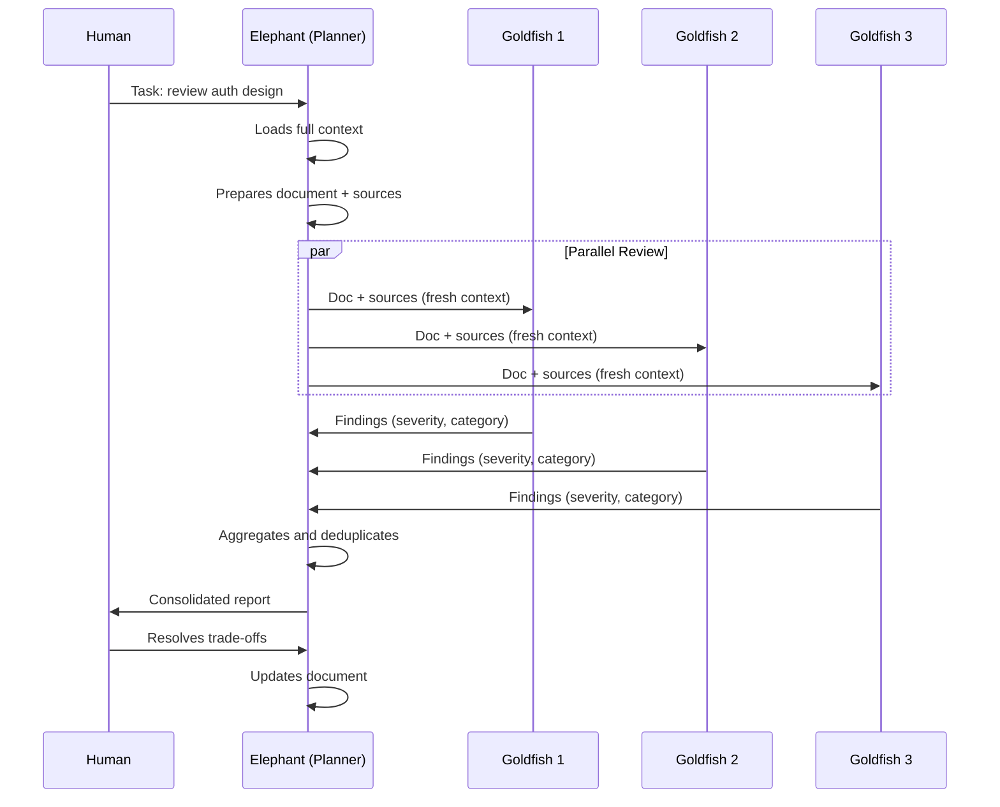

[🇧🇷 Português](../../adr/007-inspiracao-elephant-goldfish.md) | 🇺🇸 English

# ADR-007: Inspiration — Elephant-Goldfish Model (EGM)

## Status

accepted

## Context

Google's [Elephant-Goldfish Model (EGM)](https://github.com/google/elephant-goldfish-model) presents a powerful pattern for reviewing documents and specifications with AI agents:

- **Elephant**: agent that holds the full project context. Brainstorms, writes concept briefs, and drafts specifications.
- **Goldfish**: reviewers in **fresh** contexts (subagents). They see only the document and referenced source material, never the prior conversation. They find undeclared assumptions, ambiguous requirements, misalignment with code, and implementation risks.
- **Human**: resolves trade-offs and approves.

EGM includes skills such as:
- `brainstorm`: generates initial ideas
- `draft`: drafts a specification
- `resolve`: consolidates feedback
- `bootstrap`: documents an existing codebase
- `review`: single review
- `review-loop`: configurable reviewer group with standards
- `drift-report`: compares docs with current code

**Critical requirement**: if the agent cannot create fresh contexts, review stops. Context isolation is essential.

## Decision

Adopt the Elephant-Goldfish pattern as a first-class workflow in toolbelt, mapping it to the existing agent hierarchy.

### Mapping to the Hierarchy

```
EGM                    toolbelt
───────────────────────────────────────
Elephant          →    Planner (full context)
Goldfish (N)      →    Workers/Reviewers (fresh context)
Human             →    Human (approves via tb md or CLI)
```

### Implementation

1. **`tb review`**: spawns N goldfish reviewers in fresh contexts
2. **`tb drift`**: compares vault/docs against the code graph
3. **Mandatory context isolation**: reviewers do not inherit the planner's context

### Reinforced Principles

EGM reinforces two principles already present in toolbelt:

| Existing Principle | How EGM Reinforces It |
|--------------------|-----------------------|
| Implementer ≠ evaluator | Goldfish reviewer is never the elephant author |
| Minimal context per level | Goldfish receives only doc + sources, not history |

### Isolation as Guard and Economy

Fresh goldfish context serves two purposes:

1. **Quality guard**: a reviewer without context finds gaps that the context-blind author misses
2. **Token economy**: reviewers receive only what is needed, not the entire project

## Consequences

### Positive

- **Stricter reviews**: fresh perspectives find more problems
- **Alignment with anti-cheat**: reinforces author/reviewer separation
- **Token savings**: minimal context for reviewers
- **Structured workflow**: clear phases (draft → review → resolve)
- **Drift detection**: keeps docs in sync with code

### Negative

- **Spawn overhead**: creating N fresh contexts has a cost
- **Coordination**: aggregating feedback from multiple reviewers requires logic
- **Isolation dependency**: if the runtime does not isolate context, the benefit is lost

## Alternatives Considered

### Same-Context Review (Self-Review)

**Why considered**:
- Simpler, no subagent spawn
- Lower latency

**Why not chosen**:
- Author blindness: same context = same blind spots
- EGM benchmarks show superiority of fresh context
- Violates the implementer ≠ evaluator principle

### Review by Another Persistent Agent

**Why considered**:
- Dedicated reviewer agent accumulates experience

**Why not chosen**:
- Accumulated context contaminates future reviews
- Goldfish must be fresh by design

## Open Questions

### Integrate EGM or Reimplement?

**Option A: Call EGM skills via MCP**

```yaml
pros:
  - Leverages mature implementation
  - Active community
  - Skills already tested

cons:
  - External dependency
  - May not integrate perfectly with tb hierarchy
  - Communication overhead
```

**Option B: Reimplement natively**

```yaml
pros:
  - Full control
  - Native integration with tb agent, tb guard
  - Optimized for our case

cons:
  - More work
  - Need to replicate review-loop, drift-report logic
```

**Pending decision**: Experiment with EGM integration. If it works well, keep it. If there is significant friction (latency, incompatibilities), reimplement the critical skills (`review`, `review-loop`, `drift-report`).

### Number of Reviewers

- How many goldfish per review?
- EGM suggests 5 review stages — should we follow or adapt?
- Trade-off: more reviewers = more coverage = more cost

### Review Standards

- Which standards to configure for the review-loop?
- How to categorize finding severity?
- How to handle conflicts between reviewers?

## Proposed Flow



## References

- [Elephant-Goldfish Model](https://github.com/google/elephant-goldfish-model)
- [ADR-005: Anti-Cheat Strategy](005-anti-trapaca.md) — implementer ≠ evaluator principle
- [ADR-006: Graphify and Obsidian](006-inspiracoes-graphify-obsidian.md) — other inspirations
