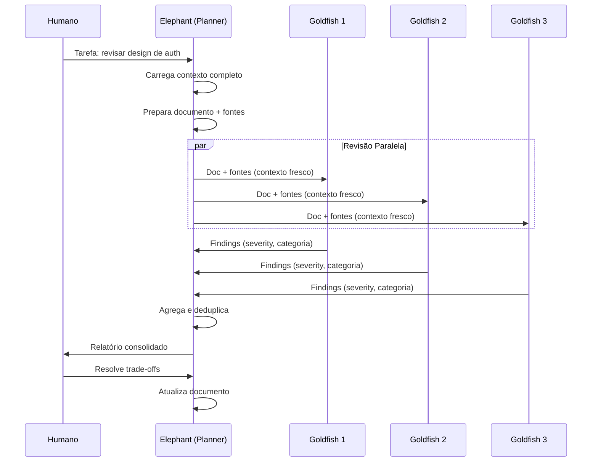

[🇺🇸 English](../../adr/007-inspiracao-elephant-goldfish.md) | 🇧🇷 Português

# ADR-007: Inspiração — Elephant-Goldfish Model (EGM)

## Status

accepted

## Contexto

O [Elephant-Goldfish Model (EGM)](https://github.com/google/elephant-goldfish-model) do Google apresenta um padrão poderoso para revisão de documentos e especificações por agentes de IA:

- **Elephant**: agente que detém o contexto completo do projeto. Faz brainstorm, escreve briefs de conceitos e redige especificações.
- **Goldfish**: revisores em contextos **frescos** (subagentes). Veem apenas o documento e o material fonte referenciado, nunca a conversa anterior. Encontram suposições não declaradas, requisitos ambíguos, desalinhamento com o código e riscos de implementação.
- **Human**: resolve trade-offs e aprova.

O EGM inclui skills como:
- `brainstorm`: gera ideias iniciais
- `draft`: redige especificação
- `resolve`: consolida feedback
- `bootstrap`: documenta codebase existente
- `review`: revisão única
- `review-loop`: grupo de revisores configurável com padrões
- `drift-report`: compara docs com código atual

**Requisito crítico**: se o agente não consegue criar contextos frescos, a revisão para. O isolamento de contexto é essencial.

## Decisão

Adotar o padrão Elephant-Goldfish como workflow de primeira classe no toolbelt, mapeando-o à hierarquia de agentes existente.

### Mapeamento para a Hierarquia

```
EGM                    toolbelt
───────────────────────────────────────
Elephant          →    Planner (contexto completo)
Goldfish (N)      →    Workers/Reviewers (contexto fresco)
Human             →    Human (aprova via tb md ou CLI)
```

### Implementação

1. **`tb review`**: spawna N revisores goldfish em contextos frescos
2. **`tb drift`**: compara vault/docs contra grafo de código
3. **Isolamento de contexto obrigatório**: revisores não herdam contexto do planner

### Princípios Reforçados

O EGM reforça dois princípios já presentes no toolbelt:

| Princípio Existente | Como EGM Reforça |
|---------------------|------------------|
| Implementador ≠ avaliador | Goldfish revisor nunca é o elephant autor |
| Contexto mínimo por nível | Goldfish recebe apenas doc + fontes, não histórico |

### Isolamento como Guarda e Economia

O contexto fresco dos goldfish serve dois propósitos:

1. **Guarda de qualidade**: revisor sem contexto encontra lacunas que o autor cego pelo contexto não vê
2. **Economia de tokens**: revisores recebem apenas o necessário, não o projeto inteiro

## Consequências

### Positivas

- **Revisões mais rigorosas**: perspectivas frescas encontram mais problemas
- **Alinhamento com anti-trapaça**: reforça separação autor/revisor
- **Economia de tokens**: contexto mínimo para revisores
- **Workflow estruturado**: fases claras (draft → review → resolve)
- **Detecção de drift**: mantém docs sincronizados com código

### Negativas

- **Overhead de spawn**: criar N contextos frescos tem custo
- **Coordenação**: agregar feedback de múltiplos revisores requer lógica
- **Dependência de isolamento**: se o runtime não isolar contexto, perde-se o benefício

## Alternativas Consideradas

### Revisão no Mesmo Contexto (Self-Review)

**Por que considerado**:
- Mais simples, sem spawn de subagentes
- Menor latência

**Por que não escolhido**:
- Cegueira do autor: mesmo contexto = mesmos pontos cegos
- Benchmarks do EGM mostram superioridade do contexto fresco
- Viola o princípio implementador ≠ avaliador

### Revisão por Outro Agente Persistente

**Por que considerado**:
- Agente revisor dedicado acumula experiência

**Por que não escolhido**:
- Contexto acumulado contamina revisões futuras
- Goldfish precisa ser fresco por design

## Questões em Aberto

### Integrar EGM ou Reimplementar?

**Opção A: Chamar skills do EGM via MCP**

```yaml
pros:
  - Aproveita implementação madura
  - Comunidade ativa
  - Skills já testados

cons:
  - Dependência externa
  - Pode não integrar perfeitamente com hierarquia tb
  - Overhead de comunicação
```

**Opção B: Reimplementar nativamente**

```yaml
pros:
  - Controle total
  - Integração nativa com tb agent, tb guard
  - Otimizado para nosso caso

cons:
  - Mais trabalho
  - Precisa replicar lógica de review-loop, drift-report
```

**Decisão pendente**: Experimentar integração com EGM. Se funcionar bem, manter. Se houver fricção significativa (latência, incompatibilidades), reimplementar as skills críticas (`review`, `review-loop`, `drift-report`).

> **Atualização (2026-11-17):** proposta de reimplementação nativa (Opção B) em [ADR-015](015-egm-nativo.md).

### Número de Revisores

- Quantos goldfish por revisão?
- EGM sugere 5 estágios de revisão — devemos seguir ou adaptar?
- Trade-off: mais revisores = mais cobertura = mais custo

### Padrões de Revisão

- Quais standards configurar para o review-loop?
- Como categorizar severity dos findings?
- Como lidar com conflitos entre revisores?

## Fluxo Proposto



## Referências

- [Elephant-Goldfish Model](https://github.com/google/elephant-goldfish-model)
- [ADR-005: Estratégia Anti-Trapaça](005-anti-trapaca.md) — princípio implementador ≠ avaliador
- [ADR-006: Graphify e Obsidian](006-inspiracoes-graphify-obsidian.md) — outras inspirações
