[🇺🇸 English](../arquitetura.md) | 🇧🇷 Português

# Arquitetura do toolbelt (`tb`)

## Visão Geral

O `toolbelt` é um conjunto de ferramentas para agentes de código com IA, unificadas sob um único binário (`tb`) e protocolo. O objetivo é fornecer um ambiente seguro, eficiente e verificável para que agentes autônomos executem tarefas de desenvolvimento.

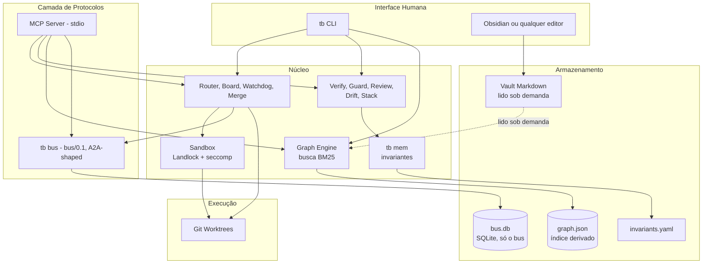

---

## 1. Workspace e Sandbox

### 1.1 Isolamento por Worktree

Cada agente opera em um **git worktree** dedicado, permitindo:

- Trabalho paralelo sem conflitos de branch
- Snapshot e rollback instantâneos via git
- Limpeza simples ao finalizar a tarefa

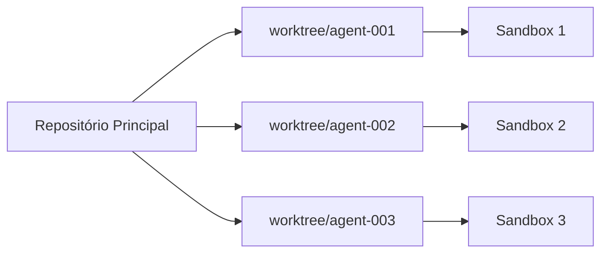

### 1.2 Camadas de Isolamento

| Camada | Tecnologia | Responsabilidade |
|--------|------------|------------------|
| Filesystem | Landlock | Restringe leitura e escrita do filho (e de seus descendentes) ao worktree, a um `TMPDIR`/`HOME` privado e aos caminhos permitidos. **Falha fechada**: sem Landlock, `tb sandbox run`, `tb router run` e `tb_run` se recusam a rodar, a menos que `--allow-unsandboxed` / `sandbox.allow_unsandboxed` esteja ligado |
| Rede | seccomp | Filtro, instalado pelo trampolim do Landlock (Linux amd64/arm64), que faz `socket(2)`, `socketpair(2)` e `io_uring` falharem com `EPERM`. É uma opção do sandbox (`DenyNetwork`), usada pelo filho de embedding do `tb graph index --vectors`; `tb sandbox run`, workers do router e `tb_run` não restringem a rede |
| Ambiente | allowlist | O filho recebe só variáveis da allowlist; nomes que parecem segredo (`*TOKEN*`, `SECRET`, `KEY`, `PASSWORD`) são bloqueados, a menos que `--pass-env` os nomeie |
| Processos | grupo de processos, subreaper, `PDEATHSIG` | Timeout ou cancelamento mata o grupo inteiro; o router varre descendentes que escaparam dele |

**Não construído, e fora do plano da 1.0:** bubblewrap (mount namespaces), cgroups v2 (limites de CPU/RAM), network namespaces e whitelist de rede por host. O `tb` limita tempo (`--timeout`), não CPU nem memória.

### 1.3 Snapshot e Rollback

O `tb` não faz snapshot, stash nem `git reset --hard` automáticos em torno de uma tarefa. Os mecanismos que existem:

1. **Worktrees**: cada worker do router, e o `tb workspace create`, recebe seu próprio git worktree em `.toolbelt/workspaces/`; descartar o trabalho é remover o worktree.
2. **Resultado do ticket**: um ticket registra `base_commit`, `head_commit` e a branch; `tb drift` e `tb review` comparam o diff com eles.
3. **`tb merge`**: aplica tickets `done` de forma atômica (`fail`, `last_wins`, `semantic`, `prompt`) e deixa um recibo; um merge recusado não move nenhuma ref.

---

## 2. Memória vs Contexto

**Memória** e **contexto** são conceitos distintos:

| Aspecto | Memória | Contexto |
|---------|---------|----------|
| **Definição** | Armazenamento persistente de fatos, decisões, sumários e grafo | O que é montado na janela do modelo para uma tarefa específica |
| **Persistência** | Permanente (vault Markdown, `graph.json`, `invariants.yaml`) | Efêmera (dura uma requisição) |
| **Tamanho** | Ilimitado (cresce com o projeto) | Limitado pelo orçamento de tokens |
| **Formato** | Markdown + frontmatter + grafo | Texto serializado para o prompt |

> **Status:** o lado da memória existe como `tb mem` (invariantes em `.toolbelt/invariants.yaml`), o vault ([§3.1](#31-vault-markdown-fonte-de-verdade)) e o grafo. Não há montador de contexto nem orçamento de tokens no `tb` (§2.1 e §2.2 descrevem a visão do design): o agente monta o próprio contexto consultando `tb_mem_list` e `tb_graph_*`, e o router entrega ao worker um arquivo de ticket.

### 2.1 Tipos de Contexto

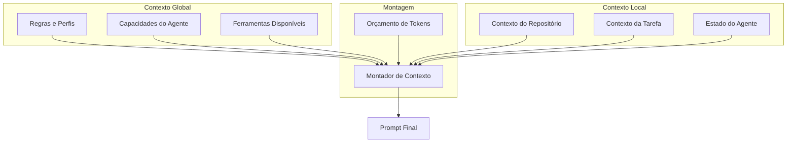

### 2.2 Hierarquia de Contexto

1. **Global**: regras do sistema, perfil do usuário, ferramentas MCP disponíveis
2. **Repositório**: estrutura do projeto, convenções, dependências principais
3. **Agente**: role/persona, histórico recente, capacidades específicas
4. **Tarefa**: objetivo, arquivos relevantes, resultados de queries no grafo

O **Montador de Contexto** recebe um orçamento de tokens e prioriza informações mais relevantes, truncando ou sumarizando quando necessário.

---

## 3. Armazenamento: Vault Markdown e o Índice Derivado do Grafo

### 3.1 Vault Markdown (Fonte de Verdade)

Inspirado no Obsidian, as notas de longo prazo são arquivos Markdown que humanos editam em qualquer editor ([spec](specs/vault.md), [ADR-016](adr/016-vault-fase-a.md)). O `tb vault` lê o disco a cada comando: não há watcher, sincronização nem índice persistente para notas. Este é o estado que o `tb` mantém num repositório:

```
.toolbelt/
├── config.yaml          # configuração local (tb init)
├── agent_docs.yaml      # dicas de AGENTS.md/CLAUDE.md registradas pelo tb init
├── invariants.yaml      # tb mem: invariantes fora da compactação
├── guard.yaml           # opcional: paths protegidos extras (lido da ref base)
├── thresholds.yaml      # opcional: piso de cobertura (lido da ref base)
├── screens.yaml         # opcional: manifesto do ruler visual
├── secchecks.yaml       # tb blue apply: checagens de segurança registradas
├── vault/               # notas Markdown com frontmatter e [[wikilinks]]
├── graph.json           # índice derivado do grafo (tb graph index)
├── graph.vec            # índice vetorial opcional (tb graph index --vectors)
├── tickets/             # TKT-*.yaml (tb ticket)
├── board.yaml           # controle do board: pause, resume, drain
├── router/              # state.json, alerts.jsonl, logs/ (tb router)
├── workspaces/          # git worktrees dos tickets em execução
├── bus/bus.db           # store SQLite do barramento local
└── egm/receipts/        # recibos EGM versionados
```

O estado privado (sessões do bus, estado do EGM, recibos de merge, estado de labs) fica fora do repositório, sob `$XDG_STATE_HOME`; veja as specs.

Cada nota usa:
- **Frontmatter YAML**: `type` (`fact`, `decision`, `context`, `log`), `tags`, `source` (`manual`, `extracted`, `inferred`), `confidence`
- **Wikilinks**: `[[outra-nota]]`, resolvidos pelo `tb vault`; links quebrados e ambíguos fazem o `tb vault check` falhar
- **Backlinks**: calculados sob demanda (`tb vault backlinks`)

### 3.2 Índice do Grafo: `graph.json` e BM25

O grafo é um índice **derivado** do código e dos docs, reconstruído sob demanda, não um banco de dados. `tb graph index` escreve `.toolbelt/graph.json`:

```json
{
  "root": "/path/to/repo",
  "nodes": [{"id": "...", "type": "function", "path": "...", "title": "...", "package": "...", "source": "extracted", "confidence": 0.9}],
  "edges": [{"source_id": "...", "target_id": "...", "type": "calls", "source": "extracted", "confidence": 0.9}],
  "fingerprint": "...",
  "built_at": "..."
}
```

- Tipos de nó: `file`, `function`, `package`, `class`, `section`, `component`, `hook`, `route`, `playbook` (e nós `note`/`tag` do vault). Tipos de aresta: `imports`, `calls`, `defines`, `links`, `tagged`, `mentions`, `renders`, `template`, `mirror`.
- A **busca** é BM25 sobre título, path e pacote, com divisão de camelCase e `snake_case` e consultas de vários termos. Não há SQL nem índice FTS5.
- **Defasagem**: o índice carrega uma impressão digital da árvore. A CLI reindexa quando ele está defasado; via MCP as consultas nunca reindexam e informam `stale: true`, então o agente chama `tb_graph_index` e repete. `tb graph rebuild` reconstrói tudo do zero.
- **Vetores opcionais**: `tb graph index --vectors` também escreve `graph.vec` (embeddings de um filho llama.cpp vendorizado, [ADR-018](adr/018-cgo-componentes-nativos.md)), usado por `tb graph search --mode semantic|hybrid`.

O SQLite existe no `tb` apenas como store do barramento local (`.toolbelt/bus/bus.db`). O índice SQLite + FTS5 com tabelas `nodes`/`edges` que o [ADR-003](adr/003-sqlite-fts5-grafo.md) propôs nunca foi construído: foi superado pelo `graph.json` ([ADR-011](adr/011-grafo-sob-demanda.md), [ADR-014](adr/014-graphify-reimplementacao.md)).

### 3.3 Vault e Grafo

O vault alimenta o grafo em um só sentido, quando o grafo é indexado: com `vault.graph` ligado (padrão), notas viram nós `note:<path>`, títulos viram nós `section`, wikilinks resolvidos viram arestas `links` e tags viram nós `tag:<tag>`. O vault é lido sem seguir symlinks. Nada escreve de volta no vault e nada o observa; se o `graph.json` estiver defasado, `tb graph index` lê o vault de novo.

### 3.4 Indexação de Código com Proveniência

Inspirado no Graphify e reimplementado no toolbelt ([ADR-014](adr/014-graphify-reimplementacao.md)), o `tb graph` indexa código com `go/ast` (Go) e extratores regex conservadores (TS/JS, Python, Rust, frameworks). tree-sitter segue como opção futura, não implementada:

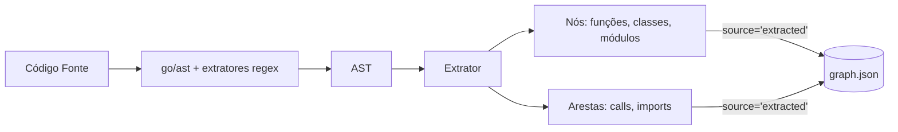

**Proveniência de arestas**: toda aresta que o indexador emite hoje tem `source: extracted` e `confidence` abaixo de 1,0 onde o extrator é heurístico (extratores regex, chamadas resolvidas de forma branda). O valor `inferred` é reservado para relações que um modelo de linguagem proporia; não existe etapa de inferência. Uma nota do vault carrega o `source` e o `confidence` do próprio frontmatter (`manual`, `extracted` ou `inferred`).

### 3.5 Queries para Agentes

O grafo expõe queries que economizam tokens:

```bash
# Quem chama esta função?
tb graph callers --function "parseConfig" --depth 2

# Quais são as dependências deste módulo?
tb graph deps --module "auth" --transitive

# Qual o impacto de mudar este arquivo?
tb graph impact --file "src/config/parser.go"

# Busca semântica
tb graph search "autenticação JWT"
```

**Hooks para agentes**: antes de ler arquivos brutos, o agente deve consultar o grafo:

```
1. Recebe tarefa: "Corrigir bug no parser de config"
2. tb graph search "parser config" → encontra nós relevantes
3. tb graph callers --function "parseConfig" → entende quem usa
4. tb graph impact --file "parser.go" → avalia escopo
5. Só então lê os arquivos específicos necessários
```

Isso reduz drasticamente o número de tokens consumidos em leitura de arquivos.

---

## 4. Segurança

### 4.1 Modelo de Ameaças

| Ameaça | Mitigação |
|--------|-----------|
| Escape do sandbox | Regras de filesystem do Landlock (falha fechada) e o filtro seccomp de rede para o filho de embedding; kill do grupo de processos no timeout |
| Acesso a segredos | Allowlist de ambiente do filho; variáveis com cara de segredo bloqueadas, a menos que `--pass-env`; redação de segredos na saída do vault e do MCP, em prompts do EGM e na entrada de embedding do grafo |
| Modificação de testes | Paths protegidos do `tb guard` (`tests/hidden/*`, `.toolbelt/thresholds.yaml`, `.toolbelt/guard.yaml`, ...) lidos da ref **base**, mais a suíte oculta do `tb verify` |
| Exfiltração de dados | O próprio `tb` é só local e nunca chama o GitHub nem serviço remoto; um filho em sandbox alcança a rede, a menos que a opção `DenyNetwork` esteja ligada (só o filho de embedding a liga) |
| Escalação de privilégio | O `tb` roda como o usuário, nunca pede root e nunca alarga um sandbox por conta própria; `--allow-unsandboxed` é um opt-in explícito |
| Reward hacking | Implementador ≠ revisor (`tb review` em contexto fresco), varredura anti-trapaça do `tb guard`, `tb drift` |

### 4.2 Permissões

Não há papéis por capacidade. O que existe:

- **Por execução**: as regras Landlock da §1.2 (worktree leitura-escrita, caminhos do sistema somente leitura).
- **Por ticket**: o mandato (`scope`, `forbidden`, `permissions`) é checado depois do fato por `tb guard`, `tb review` e `tb drift`; em tarefas do router e do bus o worker roda confinado ao seu worktree.
- **No barramento**: o papel (`router`, `supervisor`, `worker`, `reviewer`) é fixado pelo convite que o humano criou, e o broker impõe o que cada papel pode fazer ([bus-protocolo.md](bus-protocolo.md)).

### 4.3 Tokens de Capacidade: removidos

Tokens de capacidade (`CapabilityToken`), filas de aprovação e arquivos de papéis em `.tb/roles/` faziam parte do design original. O [ADR-020](adr/020-agent-hierarchy-a2a.md) removeu o `tb agent` e, com ele, esse modelo: uma ação destrutiva é decisão do humano, tomada ao rodar um comando, não um token que um agente solicita.

### 4.4 Handling de Secrets

O `tb` não guarda nem injeta segredos. O ambiente do filho é montado a partir de uma allowlist (`--env NOME` adiciona uma variável; `--pass-env NOME` é o opt-in explícito para uma que parece segredo). O `tb mem add` guarda a invariante como digitada; a saída do `tb mem` é redigida (`internal/mem/redact.go`). Texto que sai do processo (prompts do EGM, entrada de embedding de vetores) é redigido com os padrões de `internal/secrets`, e o texto de notas impresso por `tb vault --json` e `tb_vault_*` com `mem.SecretPatterns()` mais os padrões próprios do vault (`internal/vault/redact.go`).

---

## 5. Scripts e Processos

### 5.1 `tb run` e `tb proc`: planejados, não implementados

`tb run` e `tb proc` não estão na CLI, e `tb run --sandbox --allow-net` não existe. O que roda um comando hoje:

```bash
# Roda um comando sob Landlock, com timeout
tb sandbox run --timeout 30s -- go test ./...
```

O `tb_run` do MCP faz o mesmo para agentes (veja [cli.md](cli.md#mcp-tb_run-sandbox)). Supervisionar processos de longa duração (`tb proc start|list|logs|stop`) continua no roadmap do README.

### 5.2 Gerenciamento de Processos

O router e o `tb bus run` iniciam cada worker em seu próprio grupo de processos. Um timeout ou `tb watchdog kill` encerra o grupo inteiro (SIGKILL), e o router reporta como órfãos os descendentes que escaparam dele. Não há limite de CPU ou memória por processo (sem cgroups).

---

## 6. Roles e Personas: removidos

`.tb/roles/*.yaml`, capacidades e listas de ferramentas por role, e `tb:agent:spawn` saíram com o `tb agent` ([ADR-020](adr/020-agent-hierarchy-a2a.md)). A persona de um worker é o que o humano configurar no próprio agente. O `tb` sabe duas coisas de um agente: seu papel no barramento, fixado pelo convite (`router`, `supervisor`, `worker`, `reviewer`), e seu Agent Card, as capacidades que ele declara ao entrar ([bus-protocolo.md](bus-protocolo.md)).

---

## 7. TUI Markdown (`tb md`) — fora do plano

Não há TUI. `tb md` e `tb md --obsidian` saíram da Fase A do vault ([ADR-016](adr/016-vault-fase-a.md)) e não estão planejados ([ADR-020](adr/020-agent-hierarchy-a2a.md)). Qualquer editor, inclusive o Obsidian, edita o vault (`.toolbelt/vault/`, lido do disco pelo `tb vault`, sem watcher nem sync); ver [specs/vault.md](specs/vault.md). O tema visual vale para a saída de terminal e o site ([identidade-visual.md](identidade-visual.md)).

---

## 8. Rede de Agentes

### 8.1 Hierarquia

> **O que existe ([ADR-020](adr/020-agent-hierarchy-a2a.md)):** o diagrama abaixo é a visão original, não a implementação. Hoje a delegação é o `tb router run` (§8.6) entregando tickets a workers locais ou a agentes num canal do `tb bus`, com papéis do barramento fixados pelos convites do humano (`router`, `supervisor`, `worker`, `reviewer`). Não há processo planner nem `tb agent spawn`. Um segundo nível (um supervisor delegando subthreads com `parent` checado pelo broker, profundidade e fan-out limitados, `tb bus tree`) está especificado em [specs/agent-hierarchy.md](specs/agent-hierarchy.md).

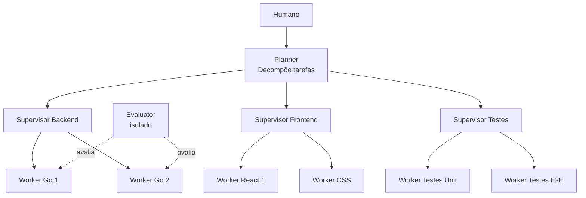

### 8.2 Fluxo de Contexto

O contexto que um worker do router recebe é o seu ticket: o mandato (escopo, paths proibidos), os critérios de aceitação e o timeout, como um arquivo apontado por `TB_TICKET_FILE`, no seu próprio worktree. Não há planner que repasse contexto por uma hierarquia; a sequência que o design original desenhou (humano, planner, supervisor, worker) é a visão, não a implementação.

### 8.3 Ciclo de Vida do Agente

O `tb` não gerencia o ciclo de vida de um agente (sem spawn, timeout ocioso ou estado de aprovação). Ele acompanha duas coisas:

- o **ticket**: `pending` → `running` → `done` | `failed` (ou `canceled`; `tb ticket retry` volta a `pending`);
- o **claim no bus** de uma thread: um lease com heartbeat e fencing por epoch, `held` → `released` | `expired` ([bus-lease.md](bus-lease.md)).

### 8.4 Orçamentos

> **Não implementado, e orçamentos de tokens não estão planejados ([ADR-020](adr/020-agent-hierarchy-a2a.md)):** o `tb` não mede os tokens de um agente de fornecedor. O que existe são os timeouts e o `retry.max_attempts` do router, o orçamento de despertares do harness (`budget.max_wakes`) e, na spec de árvores de delegação, limites de profundidade e fan-out.

Cada agente tem limites:

```yaml
budgets:
  planner:
    tokens_per_task: 50000
    max_subtasks: 10
    timeout: 30m

  supervisor:
    tokens_per_task: 20000
    max_workers: 5
    timeout: 15m

  worker:
    tokens_per_task: 8000
    max_tool_calls: 50
    timeout: 5m
```

### 8.5 Padrão Elephant-Goldfish

Inspirado no [Elephant-Goldfish Model (EGM)](https://github.com/google/elephant-goldfish-model) do Google, o toolbelt implementa um workflow de revisão com isolamento de contexto:

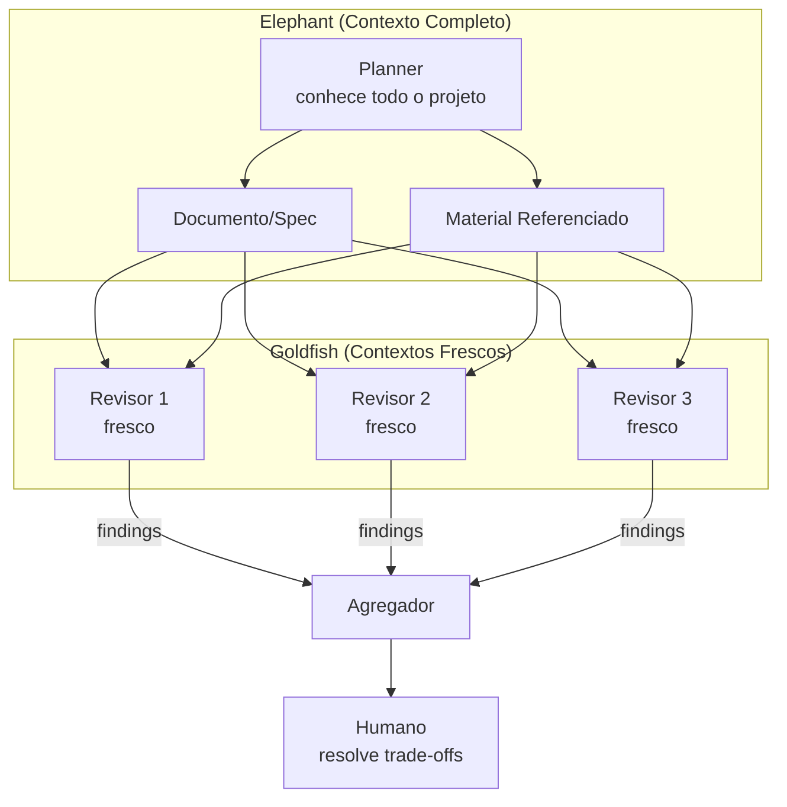

**Papéis**:

| Papel | Contexto | Responsabilidade |
|-------|----------|------------------|
| Elephant (Planner) | Completo | Redige specs, faz brainstorm, conhece o projeto todo |
| Goldfish (Reviewers) | Fresco | Revisa sem contexto prévio, encontra lacunas e suposições |
| Human | N/A | Resolve trade-offs, aprova mudanças |

**Por que contexto fresco?**

1. **Guarda de qualidade**: revisor sem contexto encontra problemas que o autor, cego pelo conhecimento acumulado, não vê
2. **Economia de tokens**: revisores recebem apenas documento + fontes, não o projeto inteiro
3. **Anti-trapaça**: reforça separação autor ≠ revisor

**Implementação via `tb review`**:

```bash
# Revisar um diff contra um ticket local com 3 goldfish distintos
tb review --ticket rd.md --reviewers 3 --standards scope,quality,acceptance

# Revisar um documento de design até a revisão convergir
tb egm review docs/design-auth.md
```

O isolamento de contexto é **obrigatório**: se o sistema não conseguir criar contextos frescos, a revisão falha ao invés de prosseguir com contexto contaminado.

### 8.6 Padrão Router/Workers

Para tarefas complexas que requerem alta paralelização e economia de contexto, o toolbelt suporta o padrão Router/Workers:

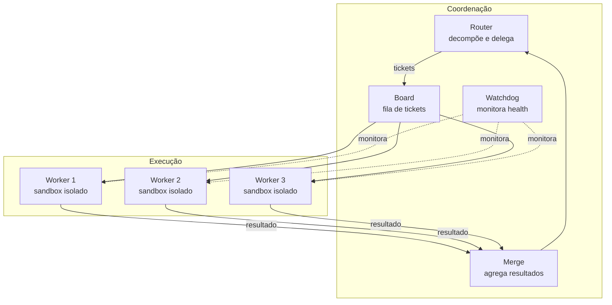

**Conceitos principais**:

| Conceito | Descrição |
|----------|-----------|
| **Ticket** | Unidade atômica de trabalho com scope, permissões e critérios de aceite |
| **Mandate** | Define quais arquivos o worker pode ler/escrever e quais são proibidos |
| **Board** | Fila de coordenação com suporte a priorização e dependências |
| **Watchdog** | Monitor que detecta workers lentos/travados e emite alertas (`worker_slow`, `worker_stuck`, `queue_growing`…); roda dentro do loop do router e não escala workers automaticamente |
| **Merge** | Agregador que resolve conflitos entre workers e aplica mudanças atomicamente |

**Fluxo de execução**:

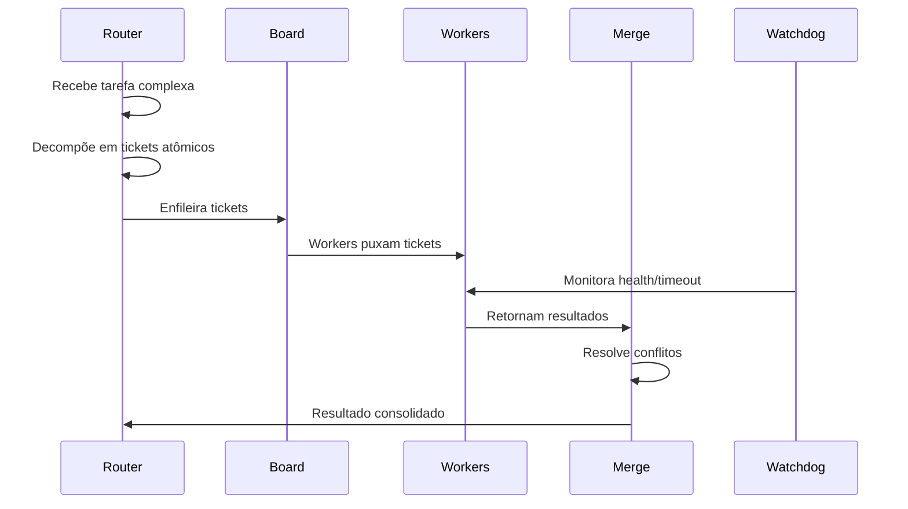

**Exemplo de Ticket**:

```yaml
ticket:
  id: "TKT-001"
  title: "Implementar handler de login"
  mandate:
    scope: ["src/handlers/auth.go", "src/services/auth.go"]
    permissions: [read, write]
    forbidden: ["src/database/*", "tests/hidden/*"]
  acceptance:
    criteria: ["Testes em tests/auth_test.go passam"]
    timeout: "10m"
  dependencies: []
```

**Benefícios**:

- **Contexto mínimo**: um worker recebe o seu ticket, não a conversa inteira (a economia não é medida; veja [ADR-009](adr/009-router-e-workers.md))
- **Paralelização**: tickets independentes executam simultaneamente
- **Isolamento de falha**: erro em um worker não polui contexto dos outros
- **Cache-read**: workers aproveitam cache de tokens via contextos repetidos
- **Auditoria**: cada ticket tem histórico isolado e rastreável

**Entrega Direta (Direct Delivery)**:

Quando um worker completa um ticket com dependentes, ele pode se inscrever para receber os tickets dependentes **diretamente**, sem passar pelo Board:

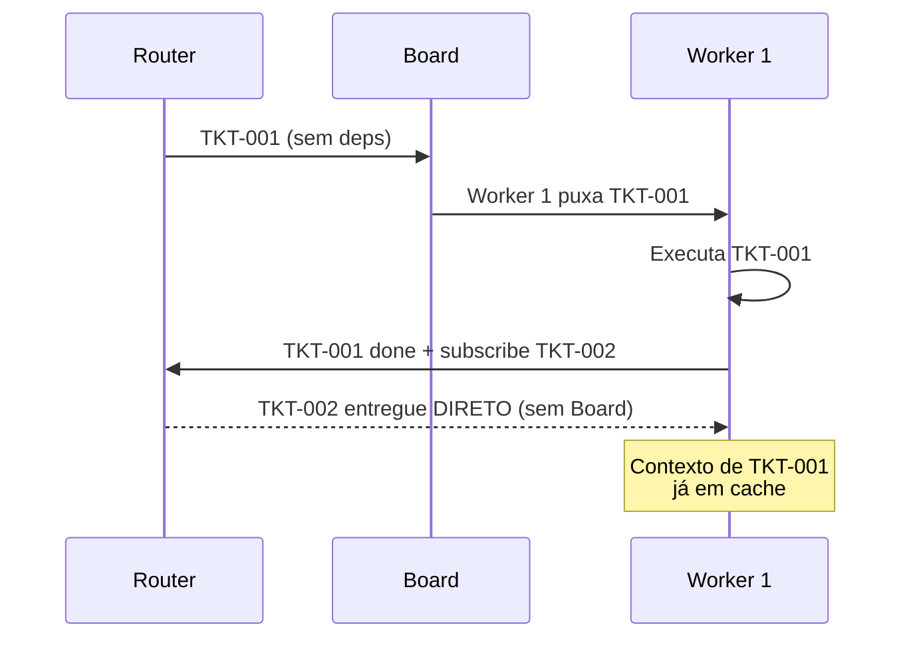

Benefícios da entrega direta:
- **Menor latência**: ticket não espera na fila
- **Afinidade de contexto**: worker já tem contexto relevante
- **Cache-read maximizado**: tokens do ticket anterior em cache
- **Menos conflitos**: mesmo worker edita arquivos relacionados

**Implementação via `tb router` e `tb ticket`**:

```bash
# Criar tickets (--title ou --from rd.md; dependências via --dep)
tb ticket create --title "Criar modelo User" --scope "src/models/**"
tb ticket create --title "JWT signing" --dep TKT-001

# Executar o router (primeiro plano; Ctrl-C devolve running -> pending)
tb router run --agent-cmd "meu-agente --task-file $TB_TICKET_FILE"

# Ver board de tickets
tb board list --status pending,running

# Monitorar workers (subscriptions ativas, contagem de alertas)
tb watchdog status

# Integrar resultados (estratégias: fail | last_wins | semantic | prompt)
tb merge TKT-001 TKT-002
```

O router é um scheduler **em primeiro plano** (`tb router run`, não há daemon
`start`/`stop`); o watchdog roda dentro do mesmo loop e persiste estado e
alertas em `.toolbelt/router/`. Detalhes em [cli.md](cli.md).

Veja [ADR-009](adr/009-router-e-workers.md) para detalhes de design.

---

## 9. Proteções Contra Trapaça

### 9.1 Princípios

1. **Separação implementador/avaliador**: quem implementa nunca avalia o próprio código
2. **Imutabilidade dos testes**: paths protegidos são checados contra a ref base, nunca contra o diff em revisão
3. **Resultados rastreáveis**: tickets, recibos de merge, recibos EGM e o log de mensagens do bus registram quem fez o quê (não há um log de auditoria único, veja §9.3)
4. **Detecção de anomalias**: o `tb guard` sinaliza padrões suspeitos no diff, e o `tb watchdog` sinaliza workers lentos ou travados

### 9.2 Proteção de Arquivos de Teste

```bash
# Compara um intervalo com os paths protegidos e a varredura anti-trapaça
tb guard check main..HEAD

# O loop do verify roda a mesma checagem primeiro, depois o ruler de testes
# (suíte oculta de tests/hidden/ quando presente)
tb verify run --base main --head HEAD
```

O `tb guard check` lê `protected_paths` de `.toolbelt/guard.yaml` na ref **base** e os mescla com os padrões (veja §12.4). Não existem os subcomandos `tb guard snapshot` nem `tb guard verify`, nem mounts somente leitura dos arquivos de teste: a proteção é uma checagem sobre o diff, não uma barreira de filesystem.

### 9.3 Log de Auditoria: não implementado

Não há `audit.log`, registro por ação, token de capacidade nem cadeia de hashes. O que existe, cada um com seu escopo:

| Registro | Onde | Conteúdo |
|----------|------|----------|
| Log de mensagens do bus | `.toolbelt/bus/bus.db` (`tb bus log`) | toda mensagem de um canal, com seu envelope |
| Resultado do ticket | `.toolbelt/tickets/TKT-*.yaml` | status, worker, commit base/head, exit code, tentativas |
| Estado e logs do router | `.toolbelt/router/` | `state.json`, `alerts.jsonl`, logs por worker |
| Recibo de merge | diretório de estado privado | o que um merge `prompt` pediu e o que aplicou |
| Recibo EGM | `.toolbelt/egm/receipts/` | afirmações do autor versionadas, certificadas pelo loop de revisão |
| Relatório do verify | `tb verify run --json` | resultado por gate e por ruler |

### 9.4 Detecção de Reward Hacking

O que o `tb guard check` detecta hoje:

| Padrão | Indicador | Ação |
|--------|-----------|------|
| Testes deletados | Um arquivo de teste é removido | `SeverityError`, exit ≠ 0 |
| Path protegido editado | O diff toca um path protegido | `SeverityError`, exit ≠ 0 |
| Skips de teste | `t.Skip()`, `it.skip`, `describe.skip`, `test.skip`, `xit`, `.only` | aviso |
| Asserções triviais | ex.: `expect(true).toBe(true)` | `SeverityError` |

Não implementado: detecção de saídas hardcoded, análise de mutação contra cobertura artificial e nota de abuso de retentativas. O `tb verify run` limita seu loop a 3 iterações e termina em `ESCALATE`.

---

## 10. Protocolos

### 10.1 Visão Geral

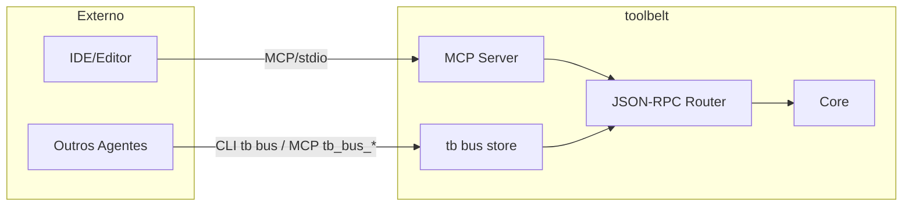

### 10.2 MCP (Model Context Protocol)

O `tb` funciona como **servidor MCP**, expondo ferramentas. O JSON abaixo é abreviado e ilustrativo (`tb_run` existe, um `sh -c` em sandbox, mas com outros parâmetros); os schemas reais vêm de `tools/list` e a lista (52 tools com `TB_GRAPH=on`) está em [cli.md](cli.md).

```json
{
  "tools": [
    {
      "name": "tb_run",
      "description": "Executa comando no sandbox",
      "inputSchema": {
        "type": "object",
        "properties": {
          "command": {"type": "string"},
          "timeout": {"type": "string"},
          "sandbox": {"type": "boolean"}
        }
      }
    },
    {
      "name": "tb_graph_search",
      "description": "Busca no grafo de conhecimento",
      "inputSchema": {
        "type": "object",
        "properties": {
          "query": {"type": "string"},
          "types": {"type": "array", "items": {"type": "string"}}
        }
      }
    },
    {
      "name": "tb_graph_callers",
      "description": "Encontra chamadores de uma função",
      "inputSchema": {
        "type": "object",
        "properties": {
          "function": {"type": "string"},
          "depth": {"type": "integer"}
        }
      }
    }
  ]
}
```

### 10.3 A2A (Agent-to-Agent)

Para comunicação entre agentes na hierarquia:

> **Decisão ([ADR-020](adr/020-agent-hierarchy-a2a.md)):** o A2A não é um transporte no `tb`. O envelope local `bus/0.1` tem o formato A2A, e o `tb` não tem servidor, cliente, socket nem HTTP A2A. Um agente A2A remoto só participa por uma ponte que o humano escreve e roda fora do `tb`, admitida como agente comum do barramento, com convite e papel próprios.

> **Implementado:** o transporte local agente ↔ agente é o barramento `tb bus` ([ADR-013](adr/013-barramento-multi-vendor.md)), com envelope JSON-RPC `bus/0.1` especificado em [bus-protocolo.md](bus-protocolo.md) sobre um store SQLite (`.toolbelt/bus/bus.db`), não Unix socket. O exemplo abaixo é ilustrativo.

```json
{
  "jsonrpc": "2.0",
  "method": "task.assign",
  "params": {
    "from_agent": "supervisor-001",
    "to_agent": "worker-002",
    "task": {
      "id": "task-123",
      "type": "implement",
      "description": "Implementar função parseConfig",
      "context": {
        "files": ["src/config/schema.go"],
        "graph_nodes": ["node-456", "node-789"]
      },
      "budget": {
        "tokens": 5000,
        "timeout": "3m"
      }
    }
  },
  "id": 1
}
```

### 10.4 Transporte

| Cenário | Transporte |
|---------|------------|
| IDE ↔ tb | stdio (MCP padrão) |
| tb ↔ processo filho | stdio + JSON-RPC |
| agente ↔ agente (local) | `tb bus`: store SQLite (`.toolbelt/bus/bus.db`), CLI ou ferramentas MCP `tb_bus_*`; sem socket |
| agente ↔ agente (remoto) | nenhum no `tb`; uma ponte que o humano roda é um agente comum do barramento ([ADR-020](adr/020-agent-hierarchy-a2a.md)) |

---

## 11. Benchmark e KPIs

Veja [docs/pt-BR/benchmark.md](benchmark.md) para detalhes completos.

### Resumo de KPIs

| KPI | Descrição | Meta | `tb bench` |
|-----|-----------|------|------------|
| `pass@1` | Taxa de sucesso na primeira tentativa | > 70% | medido |
| `tokens_per_task` | Tokens consumidos por tarefa | < baseline | medido quando o agente reporta tokens |
| `wall_time` | Tempo total de execução | < baseline | medido (por tarefa) |
| `tool_calls` | Número de chamadas de ferramentas | < baseline | medido quando o agente as reporta |
| `rework_rate` | Taxa de retrabalho | < 20% | não implementado |
| `guard_violations` | Violações de segurança bloqueadas | 0 não-bloqueadas | não implementado como KPI (o `tb guard` em si funciona) |

---

## 12. Verificação Adversarial (`tb verify`)

### 12.1 Conceito: Loop Gerador vs Discriminador

Inspirado em GANs (Generative Adversarial Networks), o toolbelt implementa um **loop adversarial** onde:

- **Gerador** (implementador): executa a tarefa e submete para verificação
- **Discriminador** (verificador): agente independente que tenta FALHAR o trabalho

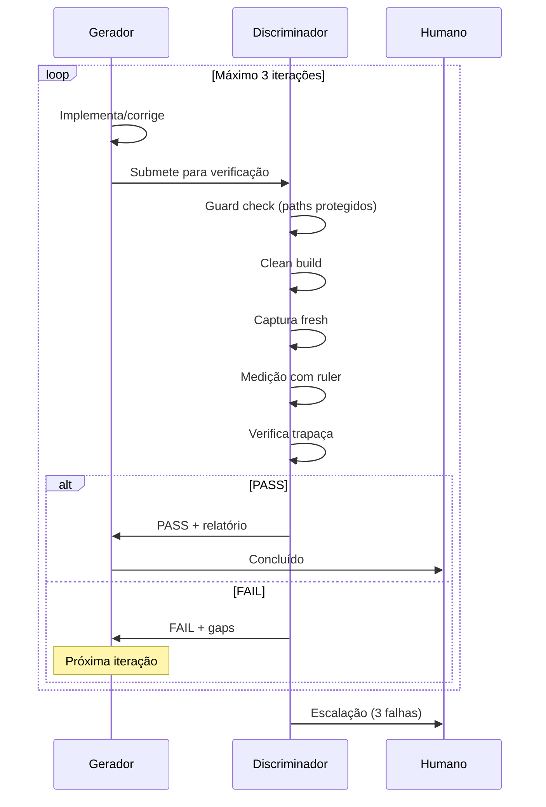

**Princípio fundamental**: Só a medição do discriminador conta como prova. Medições do gerador são informativas, nunca probatórias.

### 12.2 Rulers Plugáveis

O sistema `tb verify` é genérico, com **rulers** específicos por domínio:

| Ruler | Domínio | Métrica | Threshold |
|-------|---------|---------|-----------|
| `visual` | UI/telas | Similaridade pixel + WCAG | ≥ 95% por tela |
| `tests` | Código | Passagem em testes ocultos | 100% |
| `review` | Documentos | Cobertura de revisão fresh-context | Configurable |

Cada ruler define:
- Métrica principal e threshold de passagem
- Regras específicas de trapaça
- Formato de relatório

### 12.3 Sandbox do Discriminador

> **Esboço de design, não configuração:** o `tb verify` não lê um bloco `discriminator`. Ele roda os comandos dos gates e os rulers no worktree do head (`--base`/`--head`), com a allowlist de ambiente do filho da §1.2.

O design prevê que o discriminador opere em isolamento total:

```yaml
discriminator:
  sandbox:
    port: dedicated      # porta própria
    database: dedicated  # DB próprio
    network: isolated    # sem acesso ao gerador
  
  permissions:
    push: denied
    branch_switch: denied
    stash: denied
    fix_code: denied     # apenas reporta, nunca corrige
  
  cleanup: required      # limpa após execução
```

### 12.4 Guard Check e Paths Protegidos

Antes da medição, o discriminador executa um **guard check** sobre `base..head`:

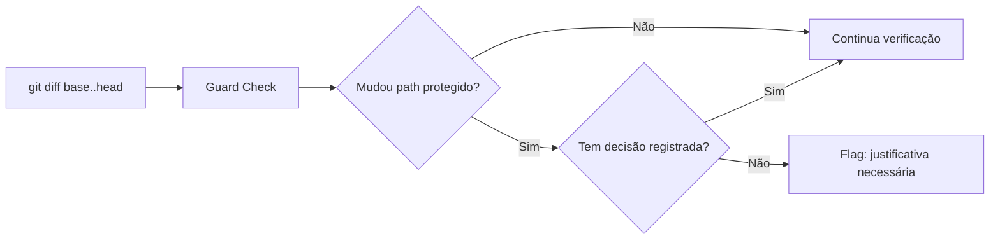

**Paths protegidos** (defaults embutidos + opcional `.toolbelt/guard.yaml`):

Defaults: `tests/hidden/*`, `benchmarks/*`, `.toolbelt/thresholds.yaml`, `.toolbelt/guard.yaml`. Entradas em `protected_paths` do YAML na **base** (string ou `pattern`) são unidas a esses defaults; arquivo ausente não remove os defaults. Matching case-insensitive com globs (`**`); YAML malformado falha fechado. Padrão com barra final (`secrets/`) é tratado como prefixo de diretório (protege filhos).

```yaml
protected_paths:
  - pattern: "references/**"
    reason: "Referências visuais não podem ser editadas sem decisão"
  
  - pattern: "masks/**"
    reason: "Masks requerem justificativa de região dinâmica"
  
  - pattern: "**/comparator.{js,ts,go}"
    reason: "Lógica de comparação é imutável"
  
  - pattern: ".toolbelt/thresholds.yaml"
    reason: "Thresholds não podem ser relaxados"
  
  - pattern: "**/*.seed"
    reason: "Seeds determinísticos são fixos"
```

Mudanças em paths protegidos **não são automaticamente trapaça**, mas requerem uma decisão registrada no vault ou aprovação explícita.

### 12.5 Definição de Trapaça

Trapaça causa **FAIL imediato**, mesmo se a métrica principal passar:

| Tipo | Descrição | Detecção |
|------|-----------|----------|
| Edição de referência | Modificar/deletar refs existentes | Guard check |
| Mask inválida | Mask sem região dinâmica real | Análise de justificativa |
| Alteração de comparador | Mudar threshold, padding, contagem | Guard check |
| Mudança de seed | Alterar seed para esconder diferenças | Guard check |
| Estado incorreto | Capturar estado diferente do projetado | Comparação com spec |
| Design invertido | Mover design em direção ao código | Diff no design |

### 12.6 Política de Iteração e Escalação

> **Parcialmente implementado:** `tb verify run` itera até 3 vezes (`MaxIterations`) e pode terminar em `ESCALATE`; as chaves YAML abaixo (`on_pass`, `notify_generator`, `block_merge`) são um esboço, não configuração.

```yaml
verification:
  max_iterations: 3
  
  on_pass:
    - log_result
    - update_audit
    - notify_generator
  
  on_fail:
    iteration_1:
      - provide_gaps
      - return_to_generator
    iteration_2:
      - provide_detailed_gaps
      - suggest_fixes
      - return_to_generator
    iteration_3:
      - escalate_to_human
      - provide_full_report
      - block_merge
```

### 12.7 Relatório do Discriminador

> **Esboço:** o relatório real é o JSON de `tb verify run --json` (veja [cli.md](cli.md)); os campos abaixo (`per_screen`, `accepted_deviations`, `design_system_followups`) não existem.

```yaml
report:
  verdict: PASS | FAIL
  
  per_screen:
    - screen: "login"
      light_mode: 97.2%
      dark_mode: 95.8%
      size_match: true
      contrast_pass: true
  
  gaps:
    - id: G1
      file: "src/components/Button.tsx"
      line: 45
      issue: "Cor do botão difere 12% do design"
      proposed_fix: "Usar var(--primary-600) ao invés de #3b82f6"
  
  accepted_deviations:
    - reason: "Fonte do sistema difere entre OS"
      approved_by: "decision-2026-01-15"
  
  design_system_followups:
    - "Considerar adicionar --primary-600 ao token set"
  
  cheating_detected: []
  
  metrics:
    build_time: "45s"
    capture_time: "12s"
    comparison_time: "3s"
```

---

## 13. Questões em Aberto

### 13.1 Integração vs Reimplementação

- **Graphify**: integrar via MCP ou reimplementar a indexação? 
  - Integração: menos trabalho, depende de manutenção externa
  - Reimplementação: controle total, pode otimizar para o caso de uso
  - **Decidido ([ADR-014](adr/014-graphify-reimplementacao.md))**: reimplementar; `tb graph explain`/`path` entregues, roadmap no ADR

### 13.2 Modelo de Inferência para Proveniência

- Qual modelo usar para inferir relações semânticas?
- Deve rodar localmente ou via API?
- Trade-off custo vs qualidade das inferências

### 13.3 Persistência do Estado do Agente

- **Respondida.** O `tb` não persiste estado de agente. O bus guarda o que é compartilhado (mensagens, convites, sessões, claims) em `.toolbelt/bus/bus.db`; a memória própria de um agente é assunto do seu fornecedor. Órfãos são tratados pelo lease do claim (expiração, fencing por epoch) e pela varredura de órfãos do router, não por um store de estado ([ADR-013](adr/013-barramento-multi-vendor.md), [ADR-020](adr/020-agent-hierarchy-a2a.md)).

### 13.4 Escalabilidade da Hierarquia

- **Respondida pelo [ADR-020](adr/020-agent-hierarchy-a2a.md).** Não há planners nem supervisors para contar: o router agenda tickets sobre um número configurável de workers, e uma árvore de delegação no bus tem profundidade e fan-out limitados ([specs/agent-hierarchy.md](specs/agent-hierarchy.md)). O balanceamento de carga é a fila do router; os ganhos de escala ainda não foram medidos ([ADR-009](adr/009-router-e-workers.md)).

### 13.5 Versionamento do Vault

- O vault deve ser versionado junto com o código?
- Como fazer merge de mudanças de memória?
- Como lidar com memória específica de branch?

---

## 14. Achados da Pesquisa (2026-11)

Em novembro de 2026, uma revisão de ~100 fontes primárias (papers, specs, blogs oficiais, repos e benchmarks) identificou achados que podem mudar o desenho do toolbelt.

Veja a documentação completa em [docs/pt-BR/pesquisa/](pesquisa/):
- [Fontes primárias](pesquisa/fontes-primarias.md) — tabelas por área com todas as fontes
- [Top 10 leituras](pesquisa/top-10.md) — as 10 fontes mais importantes para começar
- [Achados e ideias novas](pesquisa/achados.md) — propostas concretas por módulo

### Propostas Pendentes por Módulo

| Módulo | Proposta | ADR/Status |
|--------|----------|------------|
| **mem/ctx** | Arquivo de invariantes fixado fora da compactação; compactação híbrida (extração mecânica + resumo LLM) | [ADR-010](adr/010-invariantes-fora-compactacao.md) (accepted; invariantes em `tb mem` implementadas, compactação híbrida pendente) |
| **mem/ctx** | AGENTS.md como contexto local padrão; memória bitemporal com invalidação de fatos | parcial: `tb init` lê/`--write-agents` semeia `AGENTS.md`/`CLAUDE.md` (nunca sobrescreve); `tb ctx` ainda pendente |
| **grafo** | `tb graph` sob demanda com A/B por tipo de tarefa; priorizar skills humanas | [ADR-011](adr/011-grafo-sob-demanda.md) (accepted) |
| **verify** | Suíte held-out composta que o gerador nunca vê; gap visível/oculto como KPI | pendente |
| **guard** | Monitor de trajetória (nota de suspeita); padrões de trapaça além de apagar testes | pendente |
| **benchmark** | `tb bench --impossible` para detectar trapaça; pass^k além de pass@1; fronteira custo×acurácia | pendente |
| **protocolo** | `tb mcp` nasce stateless (MCP 2026-07-28); ferramentas como arquivos + busca adiada | pendente |
| **router** | Mandate com commit base e arquivos; escopos disjuntos para paralelismo; watchdog de desperdício | parcialmente em [ADR-009](adr/009-router-e-workers.md) |

**Nota**: propostas marcadas como "pendente" estão documentadas em [achados.md](pesquisa/achados.md) mas ainda não têm ADR.

---

## 15. Inspirações

O toolbelt incorpora padrões de três projetos de referência:

| Projeto | O Que Adotamos |
|---------|----------------|
| **[Graphify](https://github.com/Graphify-Labs/graphify)** | Grafo queryável, indexação via AST, proveniência (extracted vs inferred), hooks graph-first |
| **[Obsidian](https://obsidian.md/)** | Vault Markdown como fonte de verdade, wikilinks, backlinks, frontmatter YAML, local-first |
| **[Elephant-Goldfish Model](https://github.com/google/elephant-goldfish-model)** | Revisão com contexto fresco, separação autor/revisor, workflow draft→review→resolve, drift detection |

Veja os ADRs para detalhes:
- [ADR-006: Graphify e Obsidian](adr/006-inspiracoes-graphify-obsidian.md)
- [ADR-007: Elephant-Goldfish Model](adr/007-inspiracao-elephant-goldfish.md)

---

## Referências

- [MCP Specification](https://spec.modelcontextprotocol.io/)
- [Google A2A Protocol](https://github.com/google/A2A)
- [Graphify](https://github.com/Graphify-Labs/graphify)
- [Obsidian](https://obsidian.md/)
- [Elephant-Goldfish Model](https://github.com/google/elephant-goldfish-model)
- [Landlock](https://landlock.io/)
- [tree-sitter](https://tree-sitter.github.io/)
